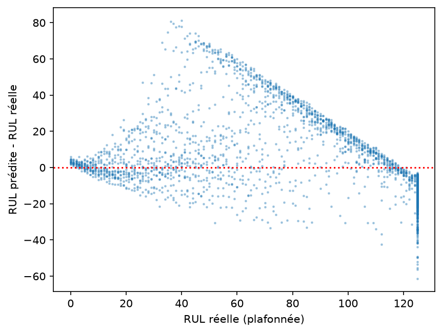
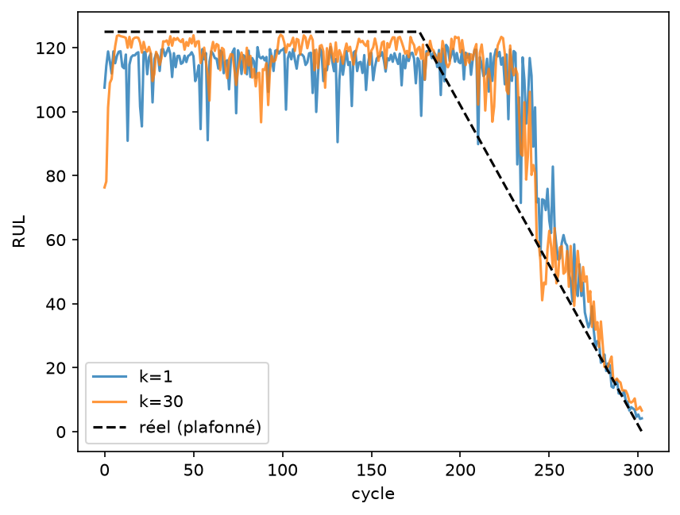
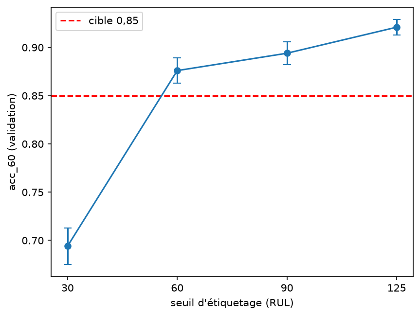
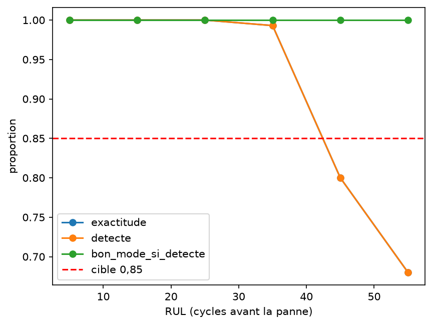
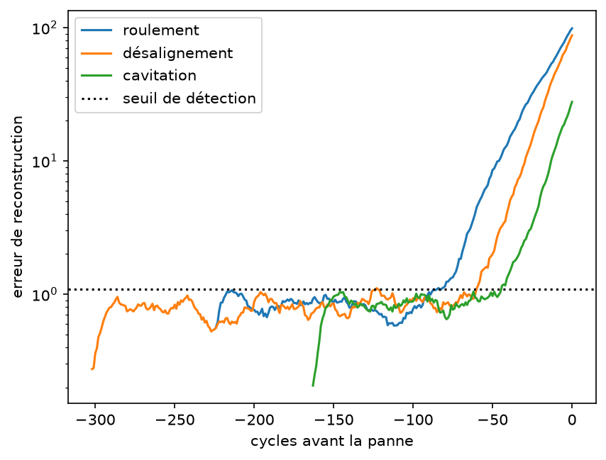
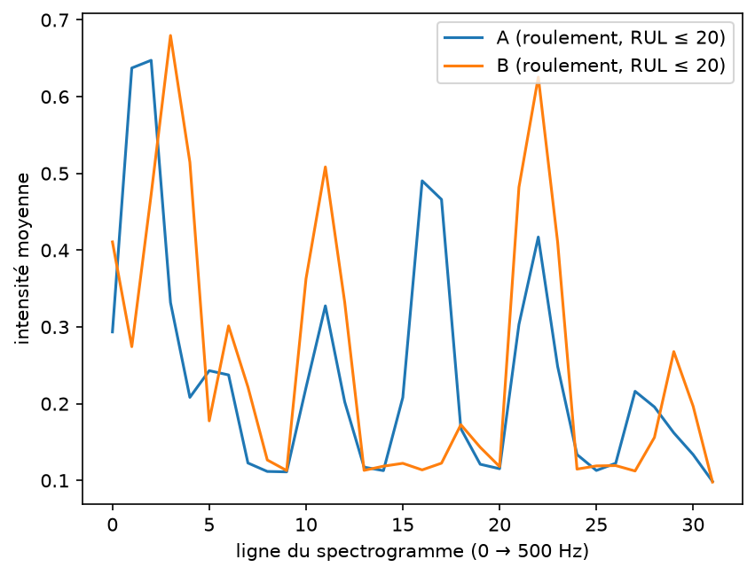
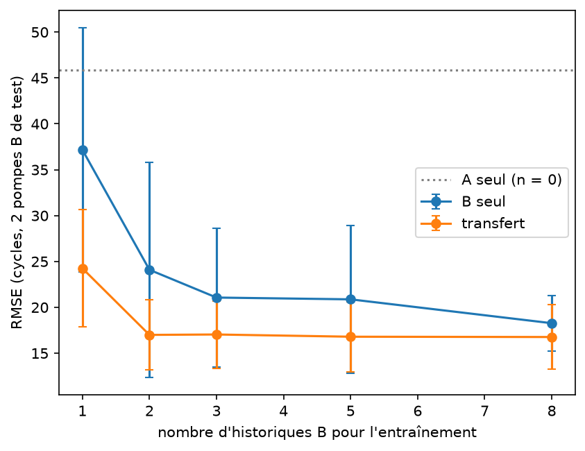

# UC5 — Maintenance prédictive des pompes : lecture critique du dossier

**Objet de ce document.** Ce fichier `one.md` explique l'ensemble du travail présent dans le dépôt : le sujet, les données, le protocole, les quatre jalons, les résultats, les figures, les points forts, les erreurs et le degré d'atteinte des exigences. Il complète — et corrige sur plusieurs points — le `report.md` déjà présent.

**Sources réellement lues**

- les quatre PDF de `jalons/` : J1 « Estimer la durée de vie restante », J2 « Écouter les vibrations », J3 « Un nouveau modèle de pompe », J4 « L'histoire de la pompe » ;
- `Consignes.pdf` à la racine ;
- les quatre notebooks `Groupe04_UC5_Jalon1.ipynb` à `Groupe04_UC5_Jalon4.ipynb`, exécutés, et le notebook complémentaire `jalon4_final.ipynb` ;
- les CSV de `result/` : journaux J1 à J4, journal final J4, résultats et prédictions finales ;
- les sept images de `figures/` ;
- `models/`, `data/` et `deploy/` (modèle, README, application Streamlit, test de chargement).

**Deux remarques préalables importantes**

1. **Le dossier `resultas/` n'existe pas.** Les résultats sont dans `result/`. C'est cette arborescence qui a été utilisée.
2. **Les quatre PDF de `jalons/` sont bien les énoncés de l'étude de cas 5, la maintenance prédictive des pompes.** Ce ne sont pas les PDF de l'étude de cas 1 sur les chèques. Le `report.md` existant affirme le contraire dans ses sections 2.1 et 11 ; c'est une erreur factuelle. Les PDF UC1 sur les chèques existent dans `data/jalons/`, ce qui explique probablement la confusion, mais le dossier racine `jalons/` contient bien UC5.

Tous les chiffres ci-dessous sont repris des sorties exécutées des notebooks et des CSV, pas du `report.md`. Les notebooks n'ont pas été réexécutés pour ce document ; il s'agit donc d'un audit des résultats déjà produits.

---

## 1. Résumé exécutif

Le projet est **globalement solide sur la démarche** : les quatre jalons sont présents, les notebooks sont exécutés, les journaux d'expériences existent, les modèles principaux sont sauvegardés, les figures sont produites et une démonstration Streamlit a même été ajoutée. Le protocole respecte l'essentiel des consignes : découpage par pompe, réglages sur la validation, test regardé une seule fois, plusieurs graines, normalisation ajustée sur le train.

Les résultats sont cependant **inégaux** :

- le **Jalon 1** est le plus convaincant sur la cible finale de RUL : RMSE test 20,83 ≤ 23 et score 344 ≤ 1 200 ; mais l'anticipation reste à 0,818 < 0,90 ;
- le **Jalon 2** atteint ses deux cibles de test (mode 0,95 ≥ 0,85 et RMSE 21,98 ≤ 23), avec un score test de 1 277, légèrement au-dessus de 1 200 ;
- le **Jalon 3** est très bon en validation croisée sur B (RMSE ≈ 16,4) mais **échoue sur le test B** (RMSE 27,99 > 24), malgré un mode parfait (1,0 sur 11 pompes) ;
- le **Jalon 4** est le meilleur en validation (GRU W = 60 : RMSE 16,90, score 516), mais le modèle final passe à **23,79 de RMSE, 1 452 de score et 0,818 d'anticipation** sur le test : trois cibles manquées ;
- la **version `jalon4_final`** ajoute l'indicateur de santé et un post-traitement métier. Elle atteint **1,00 d'anticipation** sur le test, mais en dégradant la RMSE à **25,10** et le score à **1 826**. Elle ne respecte donc pas les cibles de précision et de coût.

**Verdict synthétique** : les livrables de jalon sont largement présents, mais **aucun modèle ne réunit toutes les cibles finales**. Le meilleur compromis « précision + coût » reste le MLP asymétrique du Jalon 1 ; le meilleur compromis « anticipation » est le Jalon 4 final post-traité, au prix d'une précision et d'un score moins bons. Le diagnostic de mode est bon ; le transfert vers B reste fragile ; l'anticipation est la difficulté récurrente.

| Jalon | Modèle retenu | RMSE test | Score test | Anticipation test | Mode test | Bilan rapide |
|---|---|---:|---:|---:|---:|---|
| J1 | MLP, perte asymétrique, k = 5 | 20,83 | 344 | 0,818 | — | 3 cibles / 4 |
| J2 | CNN + AE + MLP `+HI+CNN` | 21,98 | 1 277 | — | 0,95 | mode et RMSE OK ; score légèrement hors cible |
| J3 | Transfert A → B, normalisation B | 27,99 (B) | — | — | 1,00 (B) | mode OK ; RMSE B hors cible |
| J4 | GRU W = 60, zéros + masquage | 23,79 | 1 452 | 0,818 | — | RMSE, score et anticipation hors cible |
| J4 final | LSTM W = 60 + HI + dérivées + post-traitement | 25,10 | 1 826 | 1,000 | — | anticipation OK ; RMSE et score hors cible |

---

## 2. Le sujet, les données et les cibles

### 2.1 Le problème industriel

Une flotte de pompes de lavage transmet une fois par cycle (un jour) huit mesures agrégées — températures, courant, pression, débit, vitesse, niveau et impulsivité des vibrations — ainsi qu'un spectrogramme de vibration de 32 × 32. Trois modes de défaillance existent : usure de roulement, désalignement et cavitation, plus l'état sain. La charge peut valoir 60, 80 ou 100 %.

Deux questions se superposent :

1. **Prédire la RUL** : combien de cycles reste-t-il avant la panne ? La cible est plafonnée à 125 cycles.
2. **Diagnostiquer le mode** : quel défaut affecte la pompe, parmi sain, roulement, désalignement et cavitation ?

L'enjeu industriel est double : éviter une panne imprévue (coût élevé) et éviter un remplacement trop précoce (gaspi de pièce encore en état). C'est ce qui justifie une métrique asymétrique et un intérêt particulier pour l'anticipation.

### 2.2 Les données

| Fichier | Contenu | Pompes | Cycles |
|---|---|---|---:|
| `data/uc5_flotteA.npz` | flotte A, historiques complets pour l'entraînement et la validation, historiques coupés pour le test | 70 train, 15 val, 30 test | 19 220 train, 4 170 val, 6 538 test |
| `data/uc5_flotteB.npz` | flotte B, plus rapide, peu d'historiques | 10 train, 20 test | — |

Chaque cycle contient huit capteurs, la charge, le numéro de pompe, le numéro de cycle, la RUL et le mode de défaillance pour les historiques complets. Les spectrogrammes sont des images 32 × 32, avec les fréquences de 0 à 500 Hz en ordonnée et le temps sur une seconde en abscisse.

Le découpage imposé est **par pompe** : aucune pompe ne doit être à cheval entre deux ensembles. Les notebooks respectent globalement cette règle.

### 2.3 Les cibles du cahier des charges

Les PDF précisent que ces cibles décrivent le **système final** et ne sont pas exigées à la fin de chaque jalon. Elles servent de repères pour mesurer l'écart.

| Exigence | Mesure | Cible |
|---|---|---:|
| RUL flotte A | RMSE sur la RUL plafonnée à 125 | ≤ 23 cycles |
| Coût des erreurs A | score asymétrique de type NASA | ≤ 1 200 |
| Anticipation | part des pompes à RUL ≤ 30 signalées | ≥ 0,90 |
| Fausses alertes | part des pompes à RUL > 60 signalées | ≤ 0,10 |
| Diagnostic du mode | exactitude sur les pompes à RUL ≤ 60 | ≥ 0,85 |
| RUL flotte B | RMSE sur B | ≤ 24 cycles |
| Déploiement | taille du modèle | ≤ 2 Mo |

### 2.4 Les métriques

- **RMSE** : racine de l'erreur quadratique moyenne, en cycles, sur la RUL plafonnée.
- **Score NASA** : somme de deux exponentielles asymétriques. Pour un écart \(d = \hat{y} - y\), la contribution vaut \(e^{-d/13} - 1\) si \(d < 0\), et \(e^{d/10} - 1\) sinon. Une surestimation de la RUL (panne manquée) coûte plus cher qu'une sous-estimation (alerte précoce).
- **Anticipation** : proportion des pompes à RUL réelle ≤ 30 dont la RUL prédite est < 30.
- **Fausses alertes** : proportion des pompes à RUL réelle > 60 dont la RUL prédite est < 30.
- **Exactitude du mode** : proportion de cycles ou de pompes à RUL ≤ 60 où le mode prédit est correct.
- **Corrélation de Spearman** : corrélation de rang entre l'erreur de reconstruction de l'auto-encodeur et la RUL ; une valeur négative forte est attendue.
- **Délai de détection** : RUL au moment où l'indicateur de santé dépasse son seuil pendant trois cycles consécutifs ; plus grand est meilleur.

---

## 3. Le protocole expérimental

### 3.1 Ce qui est bien fait

- **Découpage par pompe** : les cycles d'une même pompe ne sont jamais répartis entre train, validation et test.
- **Validation utilisée pour les réglages** : seuils, fenêtres, pertes, architectures et post-traitements sont choisis sur la validation.
- **Test regardé à la fin** : les notebooks utilisent un drapeau `EVAL_TEST` et ne calculent les métriques de test que dans la dernière section.
- **Plusieurs graines** : trois graines au J1, deux aux J2, J3 et J4, ce qui permet de comparer les écarts à la variabilité.
- **Normalisation par régime de charge** : les statistiques sont calculées sur les cycles sains du train (`RUL > 150`), séparément pour chaque charge.
- **Validation croisée par pompe au J3** : cinq plis, avec recalcul des statistiques de normalisation de B dans chaque pli. C'est le protocole le plus rigoureux du dossier.
- **Journal d'expériences** : chaque jalon exporte ses essais, y compris les essais infructueux.

### 3.2 Les limites du protocole

- **Validation par cycle, test par pompe.** Au J1, J2 et J4, les métriques de validation sont calculées sur tous les cycles, alors que les métriques de test sont calculées par pompe au dernier cycle observé. Les valeurs ne sont donc pas parfaitement comparables. Le J3 est plus homogène (validation croisée par pompe, test par pompe), mais les ensembles diffèrent.
- **Petits échantillons de test.** Le test A contient 30 pompes, dont 11 seulement ont une RUL ≤ 30 ; le test B contient 20 pompes, dont 11 ont une RUL ≤ 60. Les taux 0,818 ou 1,00 reposent donc sur 9/11 ou 11/11 pompes : les intervalles de confiance sont larges.
- **Le drapeau de test n'est pas une barrière technique.** `EVAL_TEST = True` est codé en dur dans la première cellule ; réexécuter le notebook réévalue le test. La discipline « une seule fois » repose sur l'utilisateur, pas sur le code.
- **Arrêt anticipé et sélection sur la même validation.** Au J2 notamment, le CNN est entraîné avec un arrêt anticipé sur la validation, puis sélectionné avec la même validation. Cela peut rendre l'estimation légèrement optimiste.
- **Peu de graines pour certaines expériences.** L'auto-encodeur et l'étude des gradients ne sont évalués qu'avec une graine ; les conclusions sur l'écrêtage ou sur le délai de détection sont donc fragiles.
- **Écart validation → test systématiquement défavorable aux J2, J3 et J4.** J2 : 17,37 → 21,98 (+4,61). J3 : 16,38 → 27,99 (+11,61). J4 : 16,95 → 23,79 (+6,84). J4 final : 18,19 → 23,93 (+5,74). Cet écart est trop grand pour être seulement du bruit d'échantillonnage ; il suggère que les tests sont plus difficiles ou que les validations sont optimistes.

---

## 4. Jalon 1 — Estimer la durée de vie restante

### 4.1 Le travail demandé

Le J1 demande de construire un MLP de référence sur le dernier cycle, puis d'étudier quatre questions :

1. reproduire la référence et tracer l'erreur selon la RUL réelle ;
2. comparer la normalisation globale et la normalisation par régime ;
3. implémenter une perte asymétrique inspirée du score et la comparer à la MSE ;
4. donner au MLP une fenêtre de \(k\) cycles aplatie, avec \(k \in \{1, 5, 15, 30\}\), et commenter le bruit des prédictions.

Les vérifications théoriques portent sur le nombre de paramètres du MLP (2 753) et sur la contribution au score pour \(d = -10, +10, -30, +30\).

### 4.2 Les résultats

**Modèle de référence** : MLP 9 → 64 → 32 → 1, sortie sigmoïde, cible `min(RUL, 125)/125`, perte MSE. Sur la validation, avec trois graines : RMSE 18,92, score 767, anticipation 0,800, aucune fausse alerte.

**Normalisation** :

| Normalisation | RMSE | Score | Anticipation |
|---|---:|---:|---:|
| Globale | 19,13 | 787 | 0,778 |
| Par régime | 18,92 | 767 | 0,800 |

Le gain est faible (0,20 cycle de RMSE), du même ordre que l'écart-type entre graines (0,16). Le notebook le reconnaît : la normalisation par régime est conservée par cohérence avec la suite, pas parce que l'ablation prouve un gain net.

**Perte asymétrique** :

| Perte | RMSE | Score | Anticipation | Biais |
|---|---:|---:|---:|---:|
| MSE | 18,92 | 767 | 0,800 | +1,13 |
| Asymétrique | 23,71 | 286 | 0,833 | −12,31 |

La perte asymétrique divise le score par environ 2,7 et rend le modèle prudent (biais négatif de 12 cycles), mais elle dégrade la RMSE de près de 5 cycles. C'est un compromis classique : sécurité contre précision moyenne.

**Fenêtre de \(k\) cycles** :

| k | RMSE | Score | Anticipation | Bruit |
|---:|---:|---:|---:|---:|
| 1 | 18,92 | 767 | 0,800 | 10,19 |
| 5 | 18,22 | 662 | 0,818 | 6,86 |
| 15 | 18,25 | 738 | 0,811 | 7,83 |
| 30 | 18,05 | 683 | **0,849** | 8,61 |

La fenêtre de 5 cycles donne le meilleur score et le signal le plus lisse. La fenêtre de 30 donne la meilleure RMSE et la meilleure anticipation, mais le bruit remonte.

**Modèle final** : perte asymétrique, \(k = 5\). Validation : RMSE 21,94, score 256,5, anticipation 0,806, biais −10,2. Test, une seule fois : **RMSE 20,83, score 344, anticipation 0,818, fausses alertes 0,00**.

*Figure 1 — J1, erreur du MLP de référence selon la RUL réelle. Les points au-dessus de zéro sont des RUL surestimées, donc des pannes manquées ; les points en dessous sont des alertes précoces. L'erreur est forte entre 30 et 90 cycles, puis faible près de la panne.*

*Figure 2 — J1, RUL prédite sur une pompe de validation pour \(k = 1\) et \(k = 30\), comparée à la RUL réelle plafonnée. La fenêtre de 30 cycles lisse la prédiction et suit mieux la dégradation.*

### 4.3 Bilan et critique du J1

**Points forts**

- Le modèle de référence est simple, bien documenté et reproductible.
- L'analyse de l'erreur par tranche de RUL est pertinente : le modèle surestime fortement la RUL entre 30 et 90 cycles, là où le défaut est encore peu visible.
- La perte asymétrique fait exactement ce qu'on attend d'elle : elle réduit fortement le score et augmente l'anticipation, au prix d'un biais prudent.
- Les vérifications théoriques sont justes (2 753 paramètres, contributions au score).
- Les cibles RMSE, score et fausses alertes sont atteintes sur le test.

**Points faibles**

1. **Le protocole de sélection n'évalue pas la combinaison retenue.** La perte est choisie dans un tableau à \(k = 1\) ; la fenêtre est choisie dans un autre tableau avec la MSE ; la combinaison « perte asymétrique + \(k = 5\) » est ensuite réentraînée à part, sans être comparée aux autres combinaisons. L'interaction perte × fenêtre n'est pas explorée.
2. **Le modèle final n'est pas le meilleur sur l'anticipation.** La MSE à \(k = 30\) atteint 0,849 d'anticipation, contre 0,806 pour le modèle retenu. La cible de 0,90 n'est atteinte par aucune variante, mais le choix final n'est pas celui qui s'en approche le plus.
3. **L'anticipation reste à 0,818 sur le test**, soit 9 pompes sur 11. C'est la cible manquée. Le modèle est précis et peu coûteux, mais il ne signale pas assez tôt une partie des pompes proches de la panne.
4. **La validation est par cycle, le test par pompe** : les 21,94 et 20,83 ne mesurent pas exactement la même chose.
5. **Le biais de −10 cycles** est volontaire, mais il faut le présenter comme un choix métier, pas comme une simple erreur : le modèle préfère alerter trop tôt.

---

## 5. Jalon 2 — Écouter les vibrations

### 5.1 Le travail demandé

Le J2 demande :

1. un CNN qui classe un spectrogramme en sain, roulement, désalignement ou cavitation, avec une règle d'étiquetage justifiée et variée ;
2. l'exactitude en fonction de la RUL, pour savoir à partir de quand le mode est reconnaissable ;
3. un auto-encodeur entraîné sur des fenêtres saines, utilisé comme indicateur de santé non supervisé, avec corrélation de rang et délai de détection ;
4. l'ajout de l'indicateur de santé ou des sorties du CNN au MLP de RUL, pour voir si la prévision s'améliore.

### 5.2 CNN et seuil d'étiquetage

Le CNN reçoit les spectrogrammes 32 × 32. Il enchaîne deux blocs de convolution 3 × 3 + pooling 2 × 2 (16 puis 32 filtres), un aplatissement, un dropout, une couche dense de 64 neurones et une sortie softmax à 4 classes. Il compte 136 196 paramètres entraînables.

Les étiquettes dépendent d'un seuil : un cycle est sain si sa RUL dépasse le seuil, sinon il prend le mode de défaillance.

| Seuil | Exactitude sur les cycles à RUL ≤ 60 |
|---:|---:|
| 30 | 0,694 |
| 60 | 0,876 |
| 90 | 0,894 |
| 125 | **0,921** |

Le seuil de 30 est trop bas : le CNN ne voit jamais de défaut entre 31 et 60 cycles, donc il ne peut pas les reconnaître. Le notebook retient 125, le seuil qui maximise l'exactitude. Le modèle final atteint 0,906 sur la validation et **0,95 sur le test** (20 pompes à RUL ≤ 60).

*Figure 3 — J2, exactitude sur les cycles à RUL ≤ 60 pour les seuils 30, 60, 90 et 125, avec les barres d'erreur et la cible de 0,85. Le saut principal se produit entre 30 et 60 ; le gain 60 → 125 est plus modeste mais suffit à retenir 125.*

### 5.3 Exactitude selon la RUL

| Tranche de RUL | Exactitude | Détecté | Bon mode si détecté |
|---|---:|---:|---:|
| 0–10 | 1,000 | 1,000 | 1,0 |
| 10–20 | 1,000 | 1,000 | 1,0 |
| 20–30 | 1,000 | 1,000 | 1,0 |
| 30–40 | 0,993 | 0,993 | 1,0 |
| 40–50 | 0,800 | 0,800 | 1,0 |
| 50–60 | 0,680 | 0,680 | 1,0 |

*Figure 4 — J2, exactitude par tranche de RUL. La baisse entre 40 et 60 cycles vient de la visibilité du défaut, pas d'une confusion entre modes : quand le défaut est détecté, le bon mode est toujours trouvé. Le mode n'est fiable que pour une RUL inférieure à 40 cycles environ.*

C'est une distinction importante : le CNN ne confond pas les modes ; il ne « voit » simplement pas encore le défaut assez tôt. Cela explique aussi pourquoi le seuil d'étiquetage élevé aide : il fournit plus d'exemples positifs, mais avec des spectrogrammes encore ambigus.

### 5.4 Auto-encodeur et indicateur de santé

L'auto-encodeur n'apprend que des fenêtres de cycles sains (`RUL > 150`). Quand la pompe se dégrade, l'erreur de reconstruction augmente et sert d'indicateur de santé, sans étiquette de panne.

| Fenêtre | Corrélation de Spearman avec la RUL | Délai médian de détection |
|---:|---:|---:|
| 1 cycle | −0,512 | 49 cycles |
| 5 cycles | −0,529 | 60 cycles |
| 15 cycles | **−0,536** | **60 cycles** |

Les corrélations sont négatives comme attendu, mais restent modérées (|ρ| ≈ 0,53). Toutes les pompes sont détectées, avec environ 1 % de fausses alertes sur les cycles sains. La fenêtre de 15 cycles est retenue pour sa corrélation légèrement meilleure.

*Figure 5 — J2, indicateur de santé de trois pompes de validation, une par mode de défaillance. L'erreur de reconstruction augmente à l'approche de la panne et franchit le seuil de détection (ligne pointillée). L'échelle verticale est logarithmique.*

Deux nuances :

- le délai médian de 60 cycles pour \(k = 5\) et \(k = 15\) est probablement **plafonné par la fenêtre** : une fenêtre de 15 cycles ne peut pas être évaluée beaucoup plus tôt que 60 cycles avant la panne. Ce n'est donc pas nécessairement une détection « à 60 cycles » au sens fort ;
- la corrélation de −0,536 est utile mais ne fait pas de l'indicateur un proxy de RUL à lui seul ; c'est un signal complémentaire.

### 5.5 Apport au MLP de RUL

Quatre variantes sont comparées : la base, la base + indicateur de santé, la base + probabilités du CNN, et la base + les deux. Les probabilités du CNN sur le train sont calculées hors pli, par validation croisée par pompe, pour éviter que le MLP leur fasse trop confiance.

| Variante | RMSE validation | Score validation (somme sur 4 170 cycles) | Score équivalent « 30 pompes » |
|---|---:|---:|---:|
| Base | 19,00 | 104 030 | ≈ 748 |
| + HI | 18,63 | 103 473 | ≈ 744 |
| + CNN | 17,48 | 73 933 | ≈ 532 |
| + HI + CNN | **17,37** | **74 356** | **≈ 535** |

Le score de la colonne centrale est une **somme sur tous les cycles de validation**, pas un score pour 30 pompes. Pour le rendre comparable à la cible de 1 200, il faut le ramener à l'échelle utilisée au J1 : \(30 \times\) moyenne par cycle, soit environ 535 pour la meilleure variante. Ainsi ramené, **le score de validation est sous 1 200** ; le seul score réellement comparable à la cible est le score de test.

Sur le test, la variante `+HI+CNN` donne **RMSE 21,98** (≤ 23), **score 1 277** (légèrement > 1 200) et **exactitude de mode 0,95** sur les 20 pompes à RUL ≤ 60.

### 5.6 Bilan et critique du J2

**Points forts**

- Le CNN est bien dimensionné et les vérifications théoriques sont exactes (136 196 paramètres, résolution 16,13 Hz, raie de roulement ligne 5 pour A et ligne 11 pour B).
- La décomposition « détection » vs « bon mode si détecté » est excellente : elle montre que le problème est la visibilité du défaut, pas la confusion entre classes.
- L'auto-encodeur fournit un indicateur non supervisé utile, avec un taux de fausses alertes très faible.
- L'ajout des probabilités du CNN améliore nettement la RMSE (19,00 → 17,37), avec un gain supérieur à l'écart-type entre graines.
- Les cibles de test du J2 (mode et RMSE) sont atteintes.

**Points faibles**

1. **Le seuil 125 est choisi par maximisation de l'exactitude, et c'est le seuil qui étiquette « défaut » le plus de cycles.** Le notebook le reconnaît : le gain vient probablement de la masse d'exemples positifs, pas d'une meilleure frontière. Cela introduit du bruit d'étiquette et rend la comparaison des seuils dépendante de la définition de la classe positive.
2. **Le score de validation du Q4 est mal échelle** : 104 030 est une somme sur 4 170 cycles, pas un score pour 30 pompes. Le notebook le signale, mais le tableau du `report.md` le présente parfois comme un score à comparer à 1 200, ce qui est trompeur.
3. **Le test du mode porte sur 20 pompes seulement**, et l'exactitude de 0,95 correspond à 19/20. L'intervalle de confiance est large.
4. **L'auto-encodeur n'est évalué qu'avec une graine**, et la corrélation reste modérée.
5. **Le délai de détection est possiblement censuré** par la longueur de fenêtre, comme indiqué plus haut.
6. **La sélection du CNN et l'arrêt anticipé utilisent la même validation**, ce qui peut surestimer légèrement l'exactitude.

---

## 6. Jalon 3 — Un nouveau modèle de pompe (flotte B)

### 6.1 Le travail demandé

Le J3 demande :

1. comparer, en validation croisée par pompe, le modèle A avec la normalisation de A, le modèle A avec une normalisation propre à B, un modèle entraîné sur B seul et l'ajustement fin du modèle A ;
2. tester si un CNN appris sur les spectrogrammes de A reconnaît les modes de B, et proposer une stratégie (rééchelonnement, augmentation, ajustement fin) ;
3. construire un modèle multitâche (tronc commun, tête RUL, tête mode) et étudier la pondération \(\lambda\) ;
4. mesurer le coût en données : combien d'historiques B faut-il pour que l'entraînement de zéro rattrape le transfert ?

Le protocole est le plus strict du dossier : validation croisée à cinq plis par pompe sur les 10 historiques B, avec recalcul des statistiques de normalisation de B dans chaque pli.

### 6.2 Transfert de la RUL vers B

| Stratégie | RMSE sur B (validation croisée) |
|---|---:|
| Modèle A avec normalisation de A | 48,19 |
| Modèle A avec normalisation de B | **16,38** |
| Entraînement de zéro sur B | 17,71 |
| Ajustement fin complet | 17,02 |
| Ajustement fin avec première couche gelée | 16,91 |
| Ajustement fin de la tête seule | 16,47 |

Le résultat central est le **décalage de covariables** : le modèle A, sans réentraînement, est très mauvais sur B s'il garde la normalisation de A. En recalculant simplement les statistiques de normalisation sur B, il tombe à 16,38. Les autres stratégies ne font pas mieux, et leurs écarts sont inférieurs à l'écart-type entre plis (3,2 à 3,8 cycles). La normalisation par régime est donc le levier principal.

### 6.3 Spectrogrammes de B

Les fréquences caractéristiques de B sont deux fois plus hautes que celles de A. Un CNN appris sur A cherche donc les motifs au mauvais endroit.

*Figure 6 — J3, profil fréquentiel moyen des spectrogrammes de roulement à RUL ≤ 20, pour A et B. Le profil de B est décalé vers les lignes hautes, ce qui illustre le facteur ≈ 2 en fréquence et explique l'échec du CNN A « tel quel ».*

| Stratégie | Exactitude du mode sur B (RUL ≤ 60) |
|---|---:|
| CNN A tel quel | 0,484 |
| Rééchelonnement de l'axe des fréquences | 0,296 |
| Augmentation par étirement en fréquence | **0,938** |
| Ajustement fin du CNN A | 0,915 |
| Ajustement fin du CNN A augmenté | 0,917 |

Le rééchelonnement échoue (0,296, très instable). L'augmentation, qui étire les spectrogrammes de A d'un facteur deux sans utiliser aucune donnée B, atteint 0,938 et dépasse la cible de 0,85. L'ajustement fin fait aussi bien, mais suppose de disposer d'historiques de B. C'est un résultat intéressant : **on peut transférer le diagnostic sans aucune donnée B**, à condition d'augmenter A pour simuler la vitesse de B.

### 6.4 Multitâche et pondération \(\lambda\)

Le modèle partage un tronc commun de deux couches denses et possède deux têtes : une pour la RUL, une pour le mode. La perte totale vaut la perte de RUL plus \(\lambda\) fois la perte de mode.

| \(\lambda\) | RMSE sur B | Exactitude du mode sur B | RMSE sur A |
|---:|---:|---:|---:|
| 0,0 | 17,02 | 0,010 | 18,93 |
| 0,1 | 17,20 | 0,842 | 18,93 |
| 0,3 | 17,14 | 0,844 | 18,95 |
| 1,0 | **17,00** | **0,845** | 19,10 |
| 3,0 | 17,07 | 0,842 | 19,27 |

La tête de mode atteint environ 0,84 dès que \(\lambda > 0\), juste sous la cible de 0,85. Mais le gain de RMSE par rapport à \(\lambda = 0\) n'est que de **0,03 cycle**, très inférieur à l'écart-type de 3,23 : **le mode n'aide pas de façon démontrée à prédire la RUL**. Un \(\lambda\) élevé dégrade légèrement la RMSE sur A. Le notebook retient \(\lambda = 1,0\) pour obtenir une tête mode sans coût mesurable, pas parce que le multitâche améliore la RUL.

### 6.5 Coût en données

| Nombre de pompes B | B seul | Transfert |
|---:|---:|---:|
| 0 | 45,82 | non applicable |
| 1 | 37,16 | 24,25 |
| 2 | 24,09 | 17,00 |
| 3 | 21,07 | 17,04 |
| 5 | 20,87 | 16,80 |
| 8 | 18,27 | 16,76 |

*Figure 7 — J3, coût en données : RMSE sur B pour l'entraînement de zéro et pour le transfert, en fonction du nombre d'historiques B, avec la référence « A seul » à \(n = 0\). Le transfert est meilleur partout et devient bon dès deux historiques ; l'entraînement de zéro ne le rattrape pas jusqu'à huit historiques. Les barres d'erreur correspondent à six tirages de deux pompes de test.*

Le transfert est meilleur partout et devient bon dès deux historiques. Pour une troisième gamme, la recommandation est donc de recalculer la normalisation par régime, de garder le modèle existant et de n'ajuster au plus que la tête.

### 6.6 Test et bilan du J3

Sur le test B (20 pompes, dernier cycle) : **RMSE 27,99** (cible ≤ 24, manquée de 4 cycles) et **exactitude du mode 1,0** sur les 11 pompes à RUL ≤ 60 (cible ≥ 0,85, atteinte).

**Points forts**

- Le protocole de validation croisée par pompe, avec normalisation recalculée dans chaque pli, est exemplaire.
- L'identification du décalage de covariables et le rôle de la normalisation par régime sont clairs et bien démontrés.
- L'augmentation en fréquence est une idée efficace et originale : 0,938 sans aucune donnée B.
- La courbe de coût en données est directement exploitable pour une décision industrielle.
- Le multitâche est étudié honnêtement : le notebook conclut à l'absence de gain significatif sur la RUL.
- Les vérifications théoriques (normalisation affine, 2 753 / 2 113 / 33 paramètres) sont justes.

**Points faibles**

1. **L'écart validation croisée → test est énorme** : 16,38 → 27,99, soit +11,6 cycles, très au-delà de l'écart-type entre plis. La validation croisée sur 10 pompes B était donc optimiste, ou le test B est distributionnellement différent. C'est le principal échec du dossier.
2. **Le test ne mesure pas la RMSE sur A**, alors que la cible A ≤ 23 figure dans l'énoncé. La RMSE A en validation croisée est de 18,93 à 19,27, donc probablement conforme, mais ce n'est pas vérifié sur le test.
3. **L'exactitude de mode de 1,0 porte sur 11 pompes** : 11/11, intervalle de confiance très large.
4. **Le rééchelonnement de l'axe des fréquences échoue** (0,296) ; le notebook l'explique, mais l'implémentation mériterait un test plus contrôlé (par exemple étirer A vers B plutôt que compresser B vers A).
5. **Les écarts entre stratégies de transfert sont souvent inférieurs à l'écart-type** : la supériorité de la normalisation B est nette, mais les différences entre ajustement fin complet, première couche gelée et tête seule ne sont pas significatives.
6. **La courbe de coût en données** repose sur une seule graine et six tirages ; les barres d'erreur sont grandes.

---

## 7. Jalon 4 — L'histoire de la pompe, et version finale

### 7.1 Le Jalon 4 standard

Le J4 demande :

1. prédire la RUL à partir d'une fenêtre de \(W\) cycles (\(W \in \{10, 30, 60\}\)) avec un LSTM puis un GRU, et comparer au MLP de référence ;
2. comparer le remplissage par répétition du premier cycle et le remplissage par zéros avec `Masking` sur les historiques courts ;
3. tracer la norme des gradients pendant l'entraînement d'un RNN simple et d'un LSTM sur des fenêtres longues, et tester l'écrêtage ;
4. facultatif : CNN par spectrogramme puis LSTM sur les cycles — non traité.

**Résultats de validation (2 graines)** :

| Modèle | W | RMSE | Score | Anticipation | Taille des poids |
|---|---:|---:|---:|---:|---:|
| MLP | 1 | 18,95 | 759 | 0,800 | 10,8 Ko |
| LSTM | 10 | 17,82 | 578 | 0,763 | 21,1 Ko |
| LSTM | 30 | 17,96 | 624 | 0,747 | 21,1 Ko |
| LSTM | 60 | 17,98 | 652 | 0,742 | 21,1 Ko |
| GRU | 10 | 17,78 | 574 | 0,758 | 16,3 Ko |
| GRU | 30 | 17,32 | 552 | 0,775 | 16,3 Ko |
| **GRU** | **60** | **16,90** | **516** | **0,811** | **16,3 Ko** |

Le GRU à \(W = 60\) est le meilleur sur les trois critères. Il s'améliore régulièrement quand la fenêtre s'allonge, alors que le LSTM plafonne autour de 18 et se dégrade en score. Le GRU est aussi plus petit que le LSTM. L'anticipation reste toutefois le point faible de tous les modèles, avec 0,811 au mieux, sous la cible de 0,90.

**Historiques courts** :

| Remplissage | RMSE sur historiques courts | Biais | RMSE sur toute la validation |
|---|---:|---:|---:|
| Répétition | 9,17 | −7,14 | 16,89 |
| Zéros + masquage | **8,70** | **−5,60** | 17,16 |

Le masquage fait un peu mieux sur les 885 cycles à historique court, mais l'écart de 0,47 cycle est inférieur aux écarts-types entre graines. Sur l'ensemble de la validation, la répétition est légèrement meilleure. Les deux options sont statistiquement équivalentes ; le notebook retient les zéros avec masquage par convention, parce que le masquage signale explicitement l'absence de donnée au lieu d'inventer un historique stable.

**Gradients** :

| Configuration | RMSE validation | Norme max du gradient | Part écrêtée |
|---|---:|---:|---:|
| RNN simple | **18,16** | 0,389 | 4 % |
| RNN simple + écrêtage | 18,46 | 0,389 | 4 % |
| LSTM | 23,31 | 0,265 | 12 % |
| LSTM + écrêtage | **22,44** | 0,265 | 28 % |

La norme du gradient par rapport à l'entrée chute d'environ cinq ordres de grandeur entre le cycle courant et le cycle le plus ancien (rapport ≈ 6,5 × 10⁻⁶ pour le RNN simple, ≈ 2,4 × 10⁻⁵ pour le LSTM). Aucune explosion franche n'est observée. L'écrêtage améliore le LSTM (23,31 → 22,44) mais **dégrade** le RNN simple (18,16 → 18,46). Il ne rend pas le LSTM stable à un taux d'apprentissage élevé.

**Test du J4 standard** : le GRU \(W = 60\) avec zéros + masquage donne **RMSE 23,79**, **score 1 452**, **anticipation 0,818**, **fausses alertes 0,00**, taille **74,5 Ko**. La RMSE manque la cible de 0,79 cycle, le score de 252, l'anticipation de 0,082.

### 7.2 La version `jalon4_final`

`jalon4_final.ipynb` reprend le pipeline séquentiel en ajoutant :

- l'indicateur de santé (HI) du Jalon 2 comme dixième variable par cycle ;
- la dérivée première de chaque variable, soit 20 canaux par cycle ;
- un post-traitement métier : si la RUL prédite est < 45 cycles **et** si \(HI > 2\), forcer la RUL à 29 cycles.

L'auto-encodeur du J2 est rechargé depuis `models/jalon2_autoencodeur.keras`. Le HI a une corrélation de Spearman de −0,536 avec la RUL sur la validation, et sa médiane est de 15,05 pour RUL ≤ 30 contre 0,17 pour RUL > 60. Le signal est donc bien informatif.

**Choix du modèle dans `jalon4_final`** : la grille Q1 sélectionne, par score minimal, **LSTM \(W = 30\)** (score 501,06, RMSE 17,69, anticipation 0,784). Pourtant, la section finale réentraîne un **LSTM \(W = 60\)** (le notebook affiche « modèle final : LSTM | W = 60 »), et la page de décisions affirme que **le GRU est retenu**. Il y a donc trois versions différentes dans le même notebook : LSTM W = 30 dans la grille, LSTM W = 60 dans le code final, GRU dans le texte. C'est une incohérence majeure.

**Remplissage** : dans `jalon4_final`, la répétition est meilleure que les zéros + masquage sur les historiques courts (7,24 contre 11,13) et sur toute la validation (17,54 contre 17,69). Le modèle final utilise pourtant les zéros + masquage. La justification « comme demandé » ne tient pas : l'énoncé demande de comparer les deux, pas d'imposer les zéros.

**Gradients dans `jalon4_final`** :

| Configuration | RMSE validation |
|---|---:|
| RNN simple | 18,61 |
| RNN simple + écrêtage | 21,31 |
| LSTM | 22,24 |
| LSTM + écrêtage | 22,48 |

Ici, l'écrêtage **dégrade les deux** modèles. L'effet n'est donc pas robuste entre les deux notebooks (dans le J4 standard, il améliore le LSTM). Il ne faut pas en tirer une conclusion générale.

**Validation et test du J4 final** :

| Version | RMSE | Score | Anticipation | Fausses alertes |
|---|---:|---:|---:|---:|
| Validation brute | 18,19 | 581 | 0,755 | 0,00 |
| Validation post-traitée | 18,88 | 594 | **0,931** | 0,003 |
| Test brut | 23,93 | 1 802 | 0,818 | 0,00 |
| Test post-traité | **25,10** | **1 826** | **1,000** | 0,00 |

Le post-traitement force 582 cycles sur 4 170 en validation, et **14 pompes sur 30** sur le test. Il transforme une prédiction hésitante autour du seuil de 30 cycles en alerte franche. Il fait passer l'anticipation de 0,818 à 1,000 sur le test, mais dégrade la RMSE (23,93 → 25,10) et le score (1 802 → 1 826). Les deux cibles de précision et de coût sont donc manquées.

Nuance importante : l'anticipation de 1,000 correspond à **11 pompes sur 11** ; c'est un petit échantillon. De plus, 3 des 14 alertes forcées concernent des pompes à RUL 32, 52 et 58, qui ne sont pas comptées comme fausses alertes parce que la définition des fausses alertes ne regarde que les RUL > 60. Le taux de 0,00 de fausses alertes est donc moins rassurant qu'il n'y paraît : le post-traitement crée des alertes précoces dans la zone 30–60, non pénalisées par la métrique.

**Taille et déploiement** : le modèle final pèse **105,7 Ko**, très en dessous de 2 Mo. Le dossier `deploy/` contient une version chargeable (`deploy/jalon4_final.keras`), un test de chargement, une application Streamlit, un `requirements.txt` et un README. Le modèle déployé est un `Masking → LSTM(32) → Dense(1, sigmoïde)` avec une entrée `(60, 20)` et 6 817 paramètres entraînables.

### 7.3 Bilan et critique du J4

**Points forts**

- La comparaison MLP / LSTM / GRU sur trois fenêtres est complète et les résultats sont cohérents : le GRU W = 60 est le meilleur en validation.
- L'étude des historiques courts est bien faite, avec une comparaison statistique honnête.
- L'étude des gradients est pédagogique et les vérifications théoriques (5 376 et 4 128 paramètres, 246 fenêtres complètes) sont justes.
- Le modèle reste minuscule (16 Ko de poids, 74,5 Ko de fichier), ce qui respecte largement la contrainte de déploiement.
- Le J4 final ajoute une information utile (HI + dérivées) et explore un post-traitement métier.
- Le déploiement Streamlit est un vrai bonus, avec un modèle opérationnel et une procédure de lancement.

**Points faibles**

1. **Le test du J4 standard manque trois cibles** : RMSE, score et anticipation. Le modèle est bon en validation (16,90 / 516 / 0,811) mais se dégrade nettement sur le test.
2. **Le J4 final ne respecte pas les cibles non plus** : RMSE 25,10 > 23, score 1 826 > 1 200. Seules l'anticipation (1,000) et la taille (105,7 Ko) sont conformes.
3. **Incohérence de modèle dans `jalon4_final`** : LSTM W = 30 dans la grille, LSTM W = 60 dans le code, GRU dans la décision.
4. **Choix du remplissage non justifié** : la répétition est meilleure dans `jalon4_final`, mais le modèle final utilise les zéros + masquage.
5. **Effet de l'écrêtage instable** : il améliore le LSTM dans le J4 standard, mais dégrade les deux modèles dans `jalon4_final`.
6. **Le post-traitement est une forme d'optimisation de la métrique d'anticipation** : il force 29 cycles et fait passer l'anticipation à 1,000, au prix de la RMSE et du score. Il faut le présenter comme un choix métier de sécurité, pas comme une amélioration globale du modèle.
7. **Le modèle final est plus mauvais que le J4 standard sur la RMSE et le score** : 23,93 / 1 802 contre 23,79 / 1 452. L'ajout du HI et des dérivées n'a pas amélioré la prédiction moyenne.
8. **Le fichier `models/jalon4_final.keras.zip`** est une archive ZIP nommée avec l'extension `.keras.zip` ; le modèle réellement chargeable est `deploy/jalon4_final.keras`. C'est une source de confusion pour la reproductibilité.

---

## 8. Les sept figures du dossier

Les sept figures sont présentes et intégrées ci-dessus. Le `report.md` existant n'en mentionne que cinq et affirme que deux figures du J3 sont absentes ; c'est faux dans l'état actuel du dépôt.

| Fichier | Ce qu'elle montre | Section |
|---|---|---|
| `figures/q1_ecart_vs_rul.png` | Erreur du MLP de référence J1 selon la RUL réelle ; surestimation entre 30 et 90 cycles, biais négatif près du plafond. | J1 |
| `figures/q4_rul_k1_vs_k30.png` | Prédictions J1 pour \(k = 1\) et \(k = 30\) sur une pompe de validation ; effet de lissage de la fenêtre. | J1 |
| `figures/q1_seuil_etiquetage.png` | Exactitude du CNN J2 selon le seuil d'étiquetage (30, 60, 90, 125), avec la cible 0,85. | J2 |
| `figures/q2_exactitude_par_rul.png` | Exactitude, détection et bon mode par tranche de RUL ; chute de détection entre 40 et 60 cycles. | J2 |
| `figures/q3_indicateur_sante.png` | Erreur de reconstruction de l'auto-encodeur pour trois pompes, une par mode, avec seuil de détection. | J2 |
| `figures/q2_profil_frequentiel_A_vs_B.png` | Profil fréquentiel moyen A vs B pour le roulement à RUL ≤ 20 ; décalage ≈ ×2 des fréquences. | J3 |
| `figures/q4_cout_en_donnees.png` | RMSE sur B selon le nombre d'historiques B, pour l'entraînement de zéro et le transfert. | J3 |

---

## 9. Les exigences sont-elles atteintes ?

### 9.1 Les cibles du système final

| Exigence | Cible | Meilleur résultat disponible | Verdict |
|---|---:|---|---|
| RUL A — RMSE | ≤ 23 | J1 test : **20,83** ; J4 test : 23,79 ; J4 final : 23,93 brut / 25,10 post | **Atteint par le J1**, pas par le modèle final J4 |
| RUL A — score | ≤ 1 200 | J1 test : **344** ; J2 test : 1 277 ; J4 test : 1 452 ; J4 final : 1 802 / 1 826 | **Atteint par le J1 seulement** |
| Anticipation | ≥ 0,90 | J1 : 0,818 ; J4 : 0,818 ; J4 final post : **1,000** | **Atteint uniquement avec le post-traitement J4 final**, au prix de la RMSE et du score |
| Fausses alertes | ≤ 0,10 | 0,00 partout | **Atteint** |
| Mode — exactitude | ≥ 0,85 | J2 test : 0,95 ; J3 test B : 1,00 | **Atteint**, sur 20 et 11 pompes |
| RUL B — RMSE | ≤ 24 | J3 test : 27,99 ; validation croisée : 16,38 | **Non atteint au test** |
| Taille | ≤ 2 Mo | J4 : 74,5 Ko ; J4 final : 105,7 Ko | **Atteint** |

**Lecture.** Aucun modèle ne réunit toutes les cibles. Si l'on prend le meilleur résultat par exigence, on peut cocher la RMSE A (J1), le score (J1), les fausses alertes, le mode et la taille. Mais ce « meilleur par exigence » mélange des modèles différents : le système final intégré n'existe pas. Le J4 final, qui est présenté comme le modèle final, ne satisfait que l'anticipation (après post-traitement), les fausses alertes et la taille.

### 9.2 Les livrables des jalons

| Livrable attendu | Présent ? | Commentaire |
|---|---|---|
| Quatre notebooks J1–J4 exécutés | **Oui** | `Groupe04_UC5_Jalon1.ipynb` à `Jalon4.ipynb`, avec sorties ; un notebook supplémentaire `jalon4_final.ipynb`. |
| Journal d'expériences par jalon | **Oui** | `result/journal_jalon1.csv` (28 lignes), `journal_jalon2.csv` (20), `journal_jalon3.csv` (131), `journal_jalon4.csv` (22), plus `journal_jalon4_final.csv` (22). |
| Page de décisions par jalon | **Oui, avec réserves** | Présente dans chaque notebook, mais le J4 final contient des incohérences (GRU/LSTM, W = 30/60). |
| Modèles sauvegardés | **Partiel** | J1, J2 et J3 sont présents dans `models/` ; le J4 standard `modele_j4.keras` est absent ; le J4 final est présent sous forme de `.keras.zip` et dans `deploy/`. |
| README avec dépendances et procédure | **Partiel** | `deploy/README.md` est complet pour le déploiement J4, mais il n'y a pas de README racine couvrant les quatre notebooks. |
| Reproductibilité | **Partielle** | Versions indiquées, graines fixées, données présentes, mais sorties d'environnements différents (chemins Windows dans le J4), versions Python/pandas légèrement différentes, et drapeau de test non bloquant. |
| Vérifications théoriques | **Oui** | Présentes et globalement correctes dans les quatre notebooks. |
| Présentation modifiable + PDF | **Absent du dépôt** | Aucun `.pptx` ni PDF de présentation à la racine. Les consignes l'exigent ; il n'est pas dans le dossier. |
| Bonus Streamlit | **Oui** | `deploy/streamlit_app.py`, `load_model.py`, `requirements.txt`, README et modèle chargeable. C'est un vrai bonus fonctionnel. |

**Conclusion sur les consignes** : le cœur du travail — notebooks, journaux, décisions, modèles, figures — est là. Les manques concernent surtout la **cohérence documentaire**, le **README racine**, la **présentation** et la **reproductibilité exacte**. Le bonus de déploiement est un point fort.

---

## 10. Ce qui est bon

1. **La démarche expérimentale est sérieuse.** Découpage par pompe, validation pour les réglages, test en fin de parcours, plusieurs graines, journaux d'essais : le socle est bon.
2. **Le J1 est un bon modèle de référence.** Il est simple, interprétable, peu coûteux, et il atteint les cibles de RMSE, de score et de fausses alertes sur le test.
3. **Le J2 apporte une vraie information.** Les spectrogrammes du CNN améliorent la RMSE du MLP de 19,00 à 17,37, et le diagnostic du mode atteint 0,95 sur le test.
4. **Le J3 est le plus rigoureux méthodologiquement.** La validation croisée par pompe avec normalisation recalculée dans chaque pli, l'étude du décalage de covariables, l'augmentation en fréquence et la courbe de coût en données sont des points forts.
5. **Le J4 est pédagogiquement complet.** La comparaison LSTM/GRU, le problème des historiques courts, l'étude des gradients et l'écrêtage sont bien traités.
6. **Le déploiement est réel.** Le modèle final se charge, l'application Streamlit existe, le README explique la procédure et le test de chargement est fourni. C'est plus qu'une simple interface vide.
7. **Les figures sont pertinentes et bien choisies.** Elles illustrent l'erreur selon la RUL, le seuil d'étiquetage, la visibilité du défaut, l'indicateur de santé, le décalage fréquentiel et le coût en données.
8. **Les vérifications théoriques sont justes.** Les calculs de paramètres, de résolution fréquentielle, de ventes et de normalisation affine sont corrects.

---

## 11. Erreurs, incohérences et fragilités

### 11.1 Erreurs factuelles ou documentaires

| # | Problème | Preuve | Impact |
|---|---|---|---|
| 1 | `report.md` affirme que les PDF de `jalons/` sont des énoncés UC1 sur les chèques. | Les PDF de `jalons/` sont les quatre énoncés UC5 sur les pompes ; les PDF UC1 sont dans `data/jalons/`. | Erreur majeure de cadrage : tout le rapport peut sembler porter sur le mauvais cas. |
| 2 | `report.md` dit que les modèles J3 et J4 sont absents. | Les modèles J3 sont présents dans `models/` ; seul `modele_j4.keras` manque, et le J4 final est dans `deploy/`. | Inventaire obsolète. |
| 3 | `report.md` dit que deux figures J3 sont absentes. | Les sept figures sont présentes, dont `q2_profil_frequentiel_A_vs_B.png` et `q4_cout_en_donnees.png`. | Inventaire obsolète. |
| 4 | `report.md` écrit que l'écrêtage « améliore la RMSE du RNN simple de 18,16 à 18,46 ». | 18,46 est **plus mauvais** que 18,16 ; c'est une dégradation. | Erreur de signe / de conclusion. |
| 5 | `report.md` reproche au J1 d'annoncer 0,87 d'anticipation et au J3 d'annoncer \(\lambda = 0,3\) avec un gain de 0,22. | Le notebook J1 actuel annonce 0,806/0,818 ; le J3 actuel annonce \(\lambda = 1,0\) et 0,03. | Les critiques sont elles-mêmes périmées. |
| 6 | La page de décisions de `jalon4_final` dit que le **GRU** est retenu. | Le code final affiche « modèle final : LSTM | W = 60 » ; `deploy/README` décrit un LSTM. | Contradiction directe dans le dossier. |
| 7 | La grille Q1 de `jalon4_final` sélectionne **LSTM W = 30**, mais le modèle final utilise **LSTM W = 60**. | Sortie Q1 : `retenu (score30 minimal) : LSTM, W = 30` ; sortie finale : `modèle final : LSTM | W = 60`. | Le choix final n'est pas celui de la grille, sans justification explicite. |
| 8 | Le fichier `models/jalon4_final.keras.zip` est une archive ZIP avec une double extension. | `deploy/README` indique qu'il a fallu l'extraire vers `deploy/jalon4_final.keras`. | Risque de chargement raté si l'on suit le nom du notebook. |

### 11.2 Problèmes méthodologiques

| # | Problème | Détail | Conséquence |
|---|---|---|---|
| 1 | **Sélection non conjointe au J1** | Perte choisie à \(k=1\), fenêtre choisie avec MSE, puis combinaison asymétrique + \(k=5\) réentraînée à part. | Le modèle final n'est pas comparé aux autres combinaisons ; l'interaction perte × fenêtre n'est pas étudiée. |
| 2 | **Anticipation mesurée par cycle en validation, par pompe au test** | J1, J2 et J4 utilisent tous les cycles en validation, puis le dernier cycle par pompe au test. | Les valeurs ne sont pas comparables ; le test est plus exigeant. |
| 3 | **Seuil d'étiquetage J2 choisi par exactitude** | Le seuil 125 étiquette « défaut » le plus de cycles ; le notebook reconnaît un possible biais de masse. | Le modèle peut apprendre des spectrogrammes encore ambigus ; la classe positive est très large. |
| 4 | **Score J2 Q4 mal échelle** | Les 104 030 / 74 356 sont des sommes sur 4 170 cycles, pas des scores pour 30 pompes. | Risque de conclure à tort que la validation dépasse 1 200 ; en équivalent 30 pompes, elle est ≈ 535. |
| 5 | **Écart validation → test très grand aux J2, J3 et J4** | +4,6 / +11,6 / +6,8 cycles de RMSE. | Les validations sont optimistes ; les tests sont plus difficiles ou les échantillons sont trop petits. |
| 6 | **Petits échantillons de test** | 11 pompes à RUL ≤ 30 au J1/J4 ; 20 pompes à RUL ≤ 60 au J2 ; 11 au J3. | Les taux 0,818, 0,95 et 1,00 ont des incertitudes larges. |
| 7 | **Choix du remplissage incohérent dans `jalon4_final`** | La répétition est meilleure (7,24 vs 11,13 sur historiques courts ; 17,54 vs 17,69 sur toute la validation), mais le modèle final utilise les zéros + masquage. | Le modèle final n'est pas le meilleur selon la validation. |
| 8 | **Effet de l'écrêtage non robuste** | J4 standard : LSTM 23,31 → 22,44 (amélioration), RNN 18,16 → 18,46 (dégradation). J4 final : RNN 18,61 → 21,31 et LSTM 22,24 → 22,48 (dégradations). | Impossible de conclure généralement que l'écrêtage améliore l'apprentissage. |
| 9 | **Post-traitement J4 final très agressif** | 582/4 170 cycles forcés en validation, 14/30 pompes sur le test ; 3 alertes forcées à RUL 32, 52 et 58 ne sont pas comptées comme fausses alertes. | L'anticipation de 1,000 est obtenue en grande partie par la règle, pas par le modèle ; le taux de fausses alertes de 0,00 est peu discriminant. |
| 10 | **Drapeau de test non bloquant** | `EVAL_TEST = True` en dur ; réexécuter le notebook réévalue le test. | La règle « test une seule fois » n'est pas garantie par le code. |
| 11 | **Validation utilisée pour l'arrêt anticipé et la sélection** | J2 et J3 notamment. | Optimisme léger des scores de validation. |
| 12 | **Une seule graine pour l'auto-encodeur et les gradients** | J2 Q3, J4 Q3. | Conclusions fragiles sur le délai de détection et l'écrêtage. |

### 11.3 Problèmes de reproductibilité et de livraison

- **Pas de README racine** : le `README.md` est dans `deploy/` et ne couvre que le J4. Les consignes demandent un README avec dépendances et procédure de lancement pour le dossier.
- **Pas de présentation** : aucun PPTX/PDF de soutenance dans le dépôt, alors que les consignes le demandent.
- **Sorties d'environnements différents** : le notebook J4 standard contient des chemins Windows (`C:\Users\amine\...`) et des versions Python 3.11.16 / pandas 3.0.5 ; `jalon4_final` est en Python 3.11.15 / pandas 3.1.0 / TensorFlow 2.21. Les résultats ne sont pas garantis identiques sur une autre machine.
- **`models/jalon4_final.keras.zip`** : archive ZIP, pas un `.keras` directement chargeable ; le modèle déployable est une copie extraite dans `deploy/`.
- **`deploy/.venv/` et `__pycache__/`** : présents localement ; le `.gitignore` les exclut, mais il faut éviter de les livrer.
- **`resultas/` demandé** : n'existe pas ; utiliser `result/`.

---

## 12. Recommandations

1. **Corriger le `report.md`** : remplacer la section UC1 par la lecture des PDF UC5, mettre à jour l'inventaire des modèles et des figures, et corriger l'erreur de signe sur l'écrêtage du RNN.
2. **Unifier le choix du modèle final J4** : décider entre LSTM W = 30 (meilleur score de la grille), LSTM W = 60 (choix actuel) et GRU W = 60 (meilleur du J4 standard), puis justifier ce choix sur la validation et le tester une seule fois. La page de décisions doit citer le même modèle que le code.
3. **Choisir le remplissage selon la validation**, pas par convention : dans `jalon4_final`, la répétition est meilleure ; soit l'utiliser, soit expliquer pourquoi on accepte un moins bon résultat.
4. **Séparer l'évaluation « modèle » et l'évaluation « règle métier »** : publier les métriques brutes et post-traitées, et ne pas présenter l'anticipation de 1,000 comme une performance du réseau seul.
5. **Mesurer l'anticipation et les fausses alertes par pompe sur la validation aussi**, pour rendre les chiffres comparables au test.
6. **Revoir le seuil d'étiquetage J2** : justifier 125 par un critère opérationnel (coût, précision du diagnostic) et non seulement par l'exactitude ; reporter la matrice de confusion et l'équilibre des classes.
7. **Reformater les scores J2 Q4** en score pour 30 pompes (ou en score moyen par cycle), pour éviter la confusion avec la cible de 1 200.
8. **Consolider le transfert B** : le test à 27,99 est le principal échec. Il faut soit plus d'historiques B, soit une calibration sur B, soit une validation croisée plus représentative ; vérifier aussi la RMSE A sur le test.
9. **Augmenter le nombre de graines** pour l'auto-encodeur, les gradients et les comparaisons de transfert, afin de distinguer effet réel et bruit.
10. **Ajouter un README racine** avec les dépendances, l'ordre d'exécution des notebooks, les chemins de données et la procédure de test. Ajouter la présentation PDF/PPTX si elle existe.
11. **Sauvegarder le modèle final dans un vrai fichier `.keras`**, pas dans une archive `.keras.zip`, et vérifier `keras.models.load_model` sur le fichier livré.

---

## 13. Verdict final

**Ce qui est réussi :**

- la structure du projet et la progression pédagogique des quatre jalons ;
- la rigueur du découpage par pompe et de la validation croisée au J3 ;
- le J1, qui reste le meilleur modèle de RUL sur le test (RMSE 20,83, score 344) ;
- le J2, qui atteint le diagnostic (0,95) et la RMSE (21,98) sur le test ;
- le J3, qui identifie correctement le décalage de covariables et propose une augmentation en fréquence efficace ;
- le J4, qui compare proprement LSTM et GRU et traite les historiques courts ;
- le bonus Streamlit, réellement fonctionnel.

**Ce qui reste insuffisant :**

- **l'anticipation** : aucune version brute n'atteint 0,90 ; le J4 final l'atteint seulement par post-traitement, en dégradant la précision ;
- **le score** : seul le J1 est sous 1 200 ; le J2 est à 1 277, le J4 à 1 452, le J4 final à 1 826 ;
- **le transfert B** : 27,99 au test contre une cible de 24, malgré une validation croisée à 16,38 ;
- **la cohérence documentaire** : le `report.md` se trompe de cas, le J4 final se contredit sur le modèle, et certains choix ne suivent pas la validation ;
- **la reproductibilité exacte** : environnements différents, test non verrouillé, modèle J4 final sous forme d'archive, README racine absent.

**Réponse directe à la question « les exigences sont-elles faites ? »** :

- **Les livrables de jalon** (notebooks, journaux, pages de décisions, vérifications théoriques, modèles principaux) sont **largement faits**, avec des réserves sur la cohérence et le modèle J4.
- **Les cibles finales du cahier des charges** sont **partiellement atteintes** : RMSE A, score, fausses alertes, mode et taille ont été atteints par au moins un modèle ; l'anticipation n'est atteinte que par le post-traitement J4 final ; la RMSE B n'est pas atteinte. **Aucun modèle unique ne satisfait toutes les cibles.**
- **La présentation et le README racine** demandés par les consignes ne sont pas présents dans le dépôt.

En l'état, le dossier est un bon travail d'expérimentation et de comparaison, mais il ne constitue pas encore une démonstration complète et cohérente du système final. Les priorités sont la cohérence du modèle J4, la correction du rapport, la mesure honnête de l'anticipation et le transfert B.

---

## Annexe A — Inventaire des fichiers

### Notebooks

| Fichier | Rôle |
|---|---|
| `Groupe04_UC5_Jalon1.ipynb` | J1 : MLP, normalisation, perte asymétrique, fenêtres, test. |
| `Groupe04_UC5_Jalon2.ipynb` | J2 : CNN, seuil d'étiquetage, auto-encodeur, MLP enrichi. |
| `Groupe04_UC5_Jalon3.ipynb` | J3 : transfert A → B, spectrogrammes, multitâche, coût en données. |
| `Groupe04_UC5_Jalon4.ipynb` | J4 : LSTM/GRU, historiques courts, gradients, test. |
| `jalon4_final.ipynb` | Version finale : HI + dérivées + post-traitement + déploiement. |

### Journaux et résultats

| Fichier | Lignes | Contenu |
|---|---:|---|
| `result/journal_jalon1.csv` | 28 | Référence, normalisations, pertes, fenêtres, modèle final. |
| `result/journal_jalon2.csv` | 20 | Seuils, exactitude par tranche, auto-encodeur, variantes MLP. |
| `result/journal_jalon3.csv` | 131 | Transfert, spectrogrammes, multitâche, coût en données. |
| `result/journal_jalon4.csv` | 22 | MLP/LSTM/GRU, remplissages, gradients. |
| `result/journal_jalon4_final.csv` | 22 | Grille finale, gradients, post-traitement. |
| `result/resultats_jalon4_final.csv` | 2 | Test J4 final avant/après post-traitement. |
| `result/predictions_test_jalon4_final.csv` | 30 | Prédictions par pompe, HI, alerte forcée. |

### Modèles

- `models/jalon1_mlp_reference.keras` : MLP de référence J1.
- `models/jalon1_final.keras` : MLP final J1 (asymétrique, k = 5).
- `models/jalon2_cnn_retenu.keras` : CNN de classification J2.
- `models/jalon2_autoencodeur.keras` : auto-encodeur J2 (fenêtre 15).
- `models/jalon2_mlp_final.keras` : MLP de RUL J2 (`+HI+CNN`).
- `models/jalon3_mlp_A_seed0.keras`, `jalon3_mlp_A_seed1.keras` : MLP A pour le transfert.
- `models/jalon3_cnn_A_seed0/1.keras`, `jalon3_cnn_AUG_seed0/1.keras` : CNN A et A augmenté.
- `models/jalon3_rul_final.keras`, `jalon3_cnn_final.keras` : modèles finaux J3.
- `models/jalon4_final.keras.zip` : archive du modèle final J4 ; le fichier chargeable est `deploy/jalon4_final.keras`.
- `modele_j4.keras` (J4 standard) : **absent** du dépôt.

### Figures

Les sept fichiers de `figures/` sont listés et intégrés dans la section 8.

### Données

- `data/uc5_flotteA.npz` : flotte A (70/15/30 pompes).
- `data/uc5_flotteB.npz` : flotte B (10 train / 20 test).
- `data/jalons/` : PDF UC1 (chèques), à ne pas confondre avec `jalons/` (UC5, pompes).

### Déploiement

- `deploy/jalon4_final.keras` : modèle Keras chargeable (LSTM, entrée 60 × 20).
- `deploy/load_model.py` : test de chargement et prédiction factice.
- `deploy/streamlit_app.py` : interface de démonstration.
- `deploy/requirements.txt` : dépendances.
- `deploy/README.md` : procédure de lancement et rappel de prétraitement.

---

## Annexe B — Chiffres de test utilisés dans ce document

| Jalon | RMSE | Score | Anticipation | Fausses alertes | Mode | Taille |
|---|---:|---:|---:|---:|---:|---:|
| J1 final | 20,83 | 344 | 0,818 | 0,00 | — | — |
| J2 `+HI+CNN` | 21,98 | 1 277 | — | — | 0,95 (20 pompes) | — |
| J3 transfert B | 27,99 | — | — | — | 1,00 (11 pompes) | — |
| J4 GRU W=60 | 23,79 | 1 452 | 0,818 | 0,00 | — | 74,5 Ko |
| J4 final brut | 23,93 | 1 802 | 0,818 | 0,00 | — | 105,7 Ko |
| J4 final post-traité | 25,10 | 1 826 | 1,000 | 0,00 | — | 105,7 Ko |

**Rappel de lecture** : les scores J1, J2, J4 et J4 final sont des sommes sur 30 pompes (ou 20 pour le mode J3) et sont comparables à la cible de 1 200. Les scores de validation du J2 Q4 ne le sont pas : ce sont des sommes sur 4 170 cycles. Les métriques de validation des J1, J2 et J4 sont par cycle, alors que les métriques de test sont par pompe au dernier cycle.
