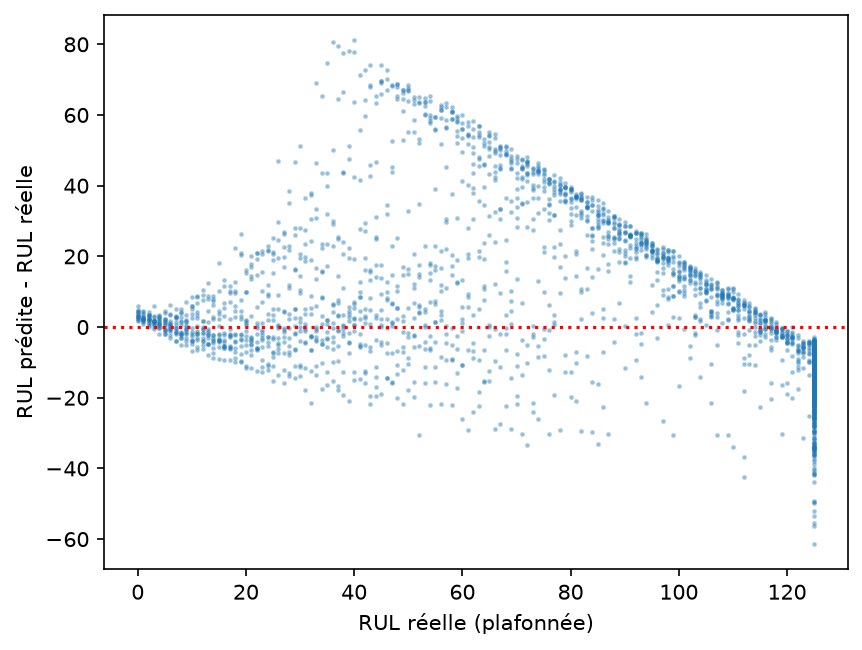
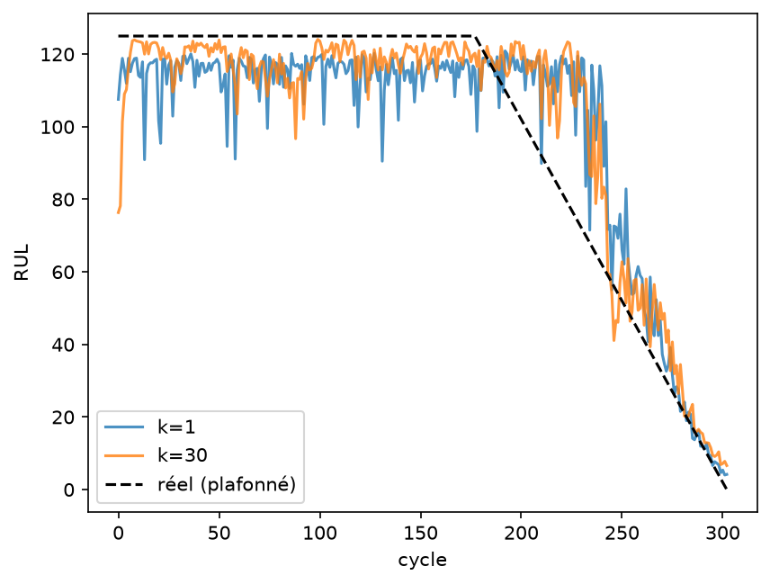
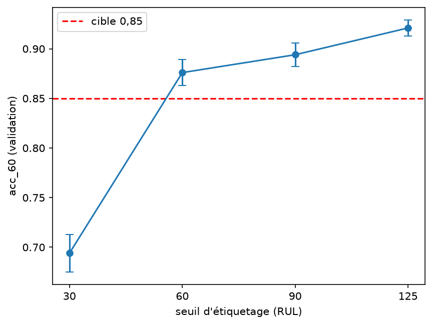
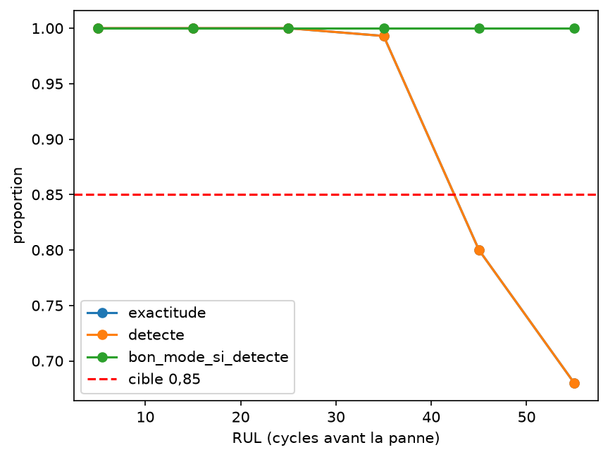
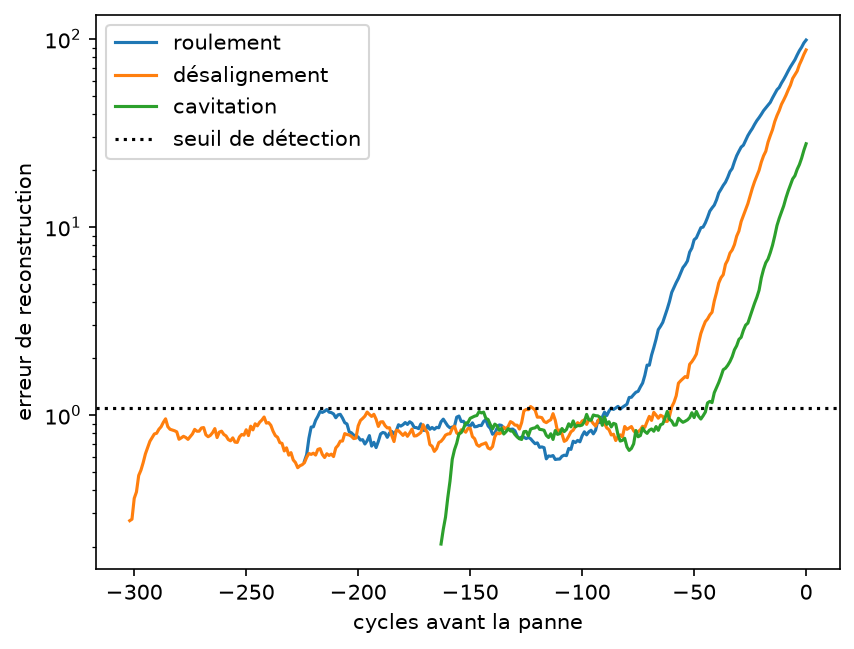

# Rapport sur les quatre jalons de maintenance prédictive

**Étude de cas 5 : estimer la durée de vie restante (RUL) d'une flotte de pompes**

Ce rapport rassemble et explique le contenu du dossier : les quatre énoncés PDF du répertoire `jalons`, les quatre journaux d'expériences du répertoire `result`, les quatre notebooks exécutés à la racine et les cinq figures du répertoire `figures`. Il donne les résultats obtenus, les décisions prises et les écarts par rapport aux cibles du cahier des charges.

---

## 1. Résumé exécutif

Le projet compare plusieurs façons d'estimer le nombre de cycles restants avant la panne d'une pompe, puis d'identifier le mode de défaillance. Le problème global est de **prédire une RUL fiable, de diagnostiquer la cause de la défaillance et de prévenir assez tôt, sur une flotte de référence comme sur une nouvelle flotte, avec peu d'étiquettes et un modèle compact**. Chaque jalon attaque une partie de ce problème : le jalon 1 construit la référence et étudie l'erreur, le jalon 2 ajoute l'information vibratoire et le diagnostic, le jalon 3 traite le changement de flotte et le multitâche, le jalon 4 introduit la dynamique temporelle. La progression est nette d'un jalon à l'autre :

| Jalon | Idée principale | Modèle retenu en validation | Résultat de test |
|---|---|---|---|
| 1 | MLP sur le dernier cycle, puis fenêtre de k cycles et perte asymétrique | RMSE 21,94 ; score 256,5 | RMSE 20,83 ; score 344 ; anticipation 0,818 |
| 2 | CNN sur spectrogrammes et auto-encodeur comme indicateur de santé | RMSE 17,37 ; mode 0,906 | RMSE 21,98 ; score 1 277 ; mode 0,95 |
| 3 | Transfert vers la nouvelle flotte B et apprentissage multitâche | RMSE B 16,38 ; mode B 0,933 | RMSE B 27,99 ; mode B 1,0 |
| 4 | Réseaux récurrents LSTM et GRU sur une fenêtre de cycles | RMSE 16,89 ; score 515,8 | RMSE 23,79 ; score 1 452 ; anticipation 0,818 |

Trois enseignements dominent :

1. La normalisation par régime de charge est le geste le plus rentable pour changer de flotte : elle fait passer la RMSE de 48,19 à 16,38 sans réentraînement.
2. Les informations issues des spectrogrammes (probabilités du CNN) et de l'auto-encodeur améliorent nettement le MLP de RUL.
3. Le GRU avec une fenêtre de 60 cycles est le meilleur modèle récurrent, mais l'anticipation reste en dessous de la cible de 0,90.

---

## 2. Ce que contient le dossier

### 2.1 Les énoncés PDF

Les quatre fichiers `jalon1.pdf`, `JALON2.pdf`, `jalons3.pdf` et `jalons4.pdf` décrivent une **autre étude de cas**, l'étude de cas 1 sur la lecture automatique de chèques de la banque Atlas. Ils servent de cadrage pédagogique pour les chapitres du cours, mais leurs données et leurs cibles ne correspondent pas aux notebooks présents.

- **Jalon 1 UC1** : lire un montant écrit à la main avec un perceptron multicouche et cinq têtes softmax à onze classes, mesurer l'exactitude par position et par longueur, étudier la confiance et le taux d'automatisation, tester l'augmentation par décalage horizontal.
- **Jalon 2 UC1** : remplacer le MLP par un CNN à cinq têtes, ajouter un détecteur de chèques altérés (AUC visée 0,95) et un auto-encodeur débruiteur pour le nouveau scanner.
- **Jalon 3 UC1** : adapter le lecteur au nouveau scanner avec seulement 600 images étiquetées, comparer entraînement de zéro, extraction de caractéristiques et ajustement fin, puis construire un modèle multitâche lecture et détection d'altération.
- **Jalon 4 UC1** : lire le montant comme une séquence avec un encodeur-décodeur récurrent, forçage par l'enseignant, décodage glouton, comparaison LSTM et GRU, contrainte de déploiement de 5 Mo et 50 ms.

Le problème global de cette étude de cas est d'automatiser la lecture des chèques de la banque Atlas **sans dépasser 1 pour cent d'erreur sur les chèques traités automatiquement**, tout en résistant aux chèques altérés et à un nouveau scanner plus pâle et plus flou dont seules 600 images sont étiquetées. Le taux d'automatisation se calcule en triant les chèques par confiance décroissante : c'est la plus grande part traitée automatiquement telle qu'au moins 99 pour cent de ces lectures soient exactes.

| Jalon UC1 | Problème | Métriques et cibles |
|---|---|---|
| 1 | Lire le montant chiffre par chiffre avec un MLP à cinq têtes, comprendre les erreurs par position et par longueur, calibrer la confiance | exactitude des montants sur le scanner A supérieure ou égale à 0,85 ; automatisation supérieure ou égale à 0,40 avec au moins 99 pour cent de lectures exactes |
| 2 | Remplacer le MLP par un CNN, détecter les chèques altérés, débruiter les images du nouveau scanner avec un auto-encodeur | exactitude sur A supérieure ou égale à 0,85 ; AUC de détection des altérations supérieure ou égale à 0,95 ; exactitude sur B supérieure ou égale à 0,70 |
| 3 | Adapter le lecteur au scanner B avec 600 images étiquetées et réunir lecture et détection dans un modèle multitâche | exactitude sur B supérieure ou égale à 0,70 ; automatisation sur B supérieure ou égale à 0,15 ; AUC sur A supérieure ou égale à 0,95 |
| 4 | Lire le montant comme une séquence de longueur variable avec un encodeur-décodeur récurrent et produire une confiance utilisable | exactitude sur A supérieure ou égale à 0,85 ; automatisation sur A supérieure ou égale à 0,40 ; taille inférieure ou égale à 5 Mo ; latence inférieure ou égale à 50 ms |

Ces cibles décrivent le système final et ne sont pas exigées à la fin de chaque jalon. Elles servent de repères pour mesurer l'écart. Les résultats numériques correspondants ne figurent pas dans ce dossier, puisque les notebooks présents portent sur l'étude de cas 5.

**Point important** : les notebooks, les journaux CSV, les figures et les modèles sauvegardés portent sur l'**étude de cas 5**, la maintenance prédictive des pompes. Les PDF ne permettent donc pas d'interpréter les chiffres produits. Ils décrivent une spécification parallèle, probablement rattachée à un autre rendu. La suite du rapport porte sur le travail réellement exécuté, celui de l'étude de cas 5.

### 2.2 Les données

Deux archives sont utilisées :

- `data/uc5_flotteA.npz` : flotte de référence, avec 70 pompes en entraînement, 15 en validation et 30 en test.
- `data/uc5_flotteB.npz` : nouvelle flotte, avec 10 pompes en entraînement et 20 en test.

Chaque cycle contient huit capteurs, une charge (60, 80 ou 100 pour cent), un numéro de pompe, un numéro de cycle, une RUL et un mode de défaillance. Les spectrogrammes sont des images 32 par 32. Les modes sont : sain, roulement, désalignement et cavitation. La RUL est plafonnée à 125 cycles. Les notebooks manipulent 19 220 cycles d'entraînement, 4 170 de validation et 6 538 de test.

### 2.3 Le protocole commun

Tous les réglages se font sur la validation, avec un découpage par pompe pour éviter qu'une même pompe soit à cheval sur deux ensembles. Le test n'est regardé qu'une fois, à la fin, quand le drapeau d'évaluation est activé. Les métriques sont la RMSE sur la RUL plafonnée, le score asymétrique de type NASA, l'anticipation (part des cycles à RUL inférieure ou égale à 30 qui sont signalés), le taux de fausses alertes et le biais moyen.

### 2.4 Le problème global

Le problème industriel est double. Il faut d'abord **estimer la durée de vie restante** d'une pompe, c'est-à-dire le nombre de cycles qui lui restent avant la panne, à partir de huit capteurs et de la charge. Il faut ensuite **identifier le mode de défaillance** parmi quatre classes : sain, roulement, désalignement et cavitation. La finalité est de planifier la maintenance au bon moment, d'éviter une panne imprévue et de savoir quelle pièce ou quel défaut préparer.

Trois difficultés structurent l'ensemble du projet :

1. **Le signal est faible loin de la panne.** Entre 60 et 125 cycles avant la panne, les capteurs et les spectrogrammes ressemblent encore à ceux d'une pompe saine. Le modèle doit donc rester prudent et ne pas inventer une dégradation qui n'est pas encore visible.
2. **Le changement de flotte crée un décalage de covariables.** La flotte B tourne deux fois plus vite et ses capteurs ne sont pas distribués comme ceux de la flotte A. Un modèle appris sur A se dégrade fortement sur B si l'on ne corrige pas ce décalage.
3. **Les données étiquetées sont rares sur la nouvelle flotte.** La flotte B ne compte que 10 pompes d'entraînement, ce qui interdit d'apprendre un modèle profond de zéro et impose le transfert, l'augmentation ou l'ajustement fin.

Le problème global peut donc se résumer ainsi : **prédire une RUL fiable et signaler les pannes assez tôt, sur la flotte de référence comme sur une nouvelle flotte, avec peu d'étiquettes et un modèle assez petit pour être déployé.**

Les cibles du cahier des charges sont les suivantes. Elles décrivent le système final, mesuré sur le test et par pompe.

| Exigence | Mesure | Cible |
|---|---|---|
| Précision de la RUL sur la flotte A | RMSE sur la RUL plafonnée à 125 | inférieure ou égale à 23 cycles |
| Coût des erreurs | score asymétrique pour 30 pompes | inférieur ou égal à 1 200 |
| Détection précoce | anticipation, part des pompes à RUL inférieure ou égale à 30 signalées avant 30 | supérieure ou égale à 0,90 |
| Sécurité | fausses alertes, part des pompes à RUL supérieure à 60 signalées à tort | inférieure ou égale à 0,10 |
| Diagnostic | exactitude du mode sur les cycles à RUL inférieure ou égale à 60 | supérieure ou égale à 0,85 |
| Transfert vers la flotte B | RMSE sur la RUL de B | inférieure ou égale à 24 cycles |
| Déploiement | taille du modèle | inférieure ou égale à 2 Mo |

### 2.5 Les métriques, leur sens et leur cible

| Métrique | Définition | Sens métier | Cible |
|---|---|---|---|
| RMSE | racine de la moyenne des carrés des écarts entre RUL prédite et RUL réelle, en cycles, sur la RUL plafonnée à 125 | erreur moyenne de précision, dans l'unité du problème | 23 cycles sur A, 24 sur B |
| Score NASA | moyenne de deux exponentielles asymétriques, multipliée par 30 pour simuler 30 pompes | coût industriel : une panne manquée coûte plus cher qu'une alerte précoce | 1 200 |
| Anticipation | part des cycles à RUL réelle inférieure ou égale à 30 dont la RUL prédite est inférieure à 30 | capacité à prévenir avant la panne | 0,90 |
| Fausses alertes | part des cycles à RUL réelle supérieure à 60 dont la RUL prédite est inférieure à 30 | coût des interventions inutiles | 0,10 |
| Biais | moyenne de la RUL prédite moins la RUL réelle | signe de l'erreur : négatif signifie trop tôt, positif signifie trop tard | aucun seuil, sert au diagnostic |
| Exactitude du mode | part des cycles à RUL inférieure ou égale à 60 où le mode prédit est le bon | qualité du diagnostic de la cause | 0,85 |
| Corrélation de Spearman | corrélation de rang entre l'erreur de reconstruction et la RUL | capacité de l'indicateur non supervisé à suivre la dégradation | proche de moins 1 |
| Délai de détection | RUL au moment où l'indicateur dépasse son seuil pendant trois cycles | précocité de l'alarme non supervisée | le plus grand possible |
| Taille | nombre de paramètres fois quatre octets, ou taille du fichier sauvegardé | contrainte de déploiement | 2 Mo |

Le score NASA mérite une explication, car il gouverne plusieurs choix. Pour un écart d égal à la RUL prédite moins la RUL réelle, la contribution vaut l'exponentielle de moins d sur 13 moins 1 si d est négatif, et l'exponentielle de d sur 10 moins 1 sinon. Une sous-estimation est donc traitée plus doucement qu'une surestimation. Le score pénalise surtout les pannes manquées et les erreurs tardives.

### 2.6 Bilan global des cibles

Le tableau suivant confronte les cibles aux résultats réellement obtenus. Les valeurs de validation sont mesurées par cycle, les valeurs de test par pompe au dernier cycle observé. La comparaison n'est donc pas parfaitement homogène, mais elle donne la tendance.

| Jalon | Métrique | Cible | Validation | Test | Verdict |
|---|---|---|---|---|---|
| 1 | RMSE | 23 | 21,94 | 20,83 | atteint |
| 1 | Score | 1 200 | 256,5 | 344 | atteint |
| 1 | Anticipation | 0,90 | 0,806 | 0,818 | non atteint |
| 1 | Fausses alertes | 0,10 | 0,000 | 0,000 | atteint |
| 2 | RMSE | 23 | 17,37 | 21,98 | atteint |
| 2 | Score | 1 200 | 74 356, somme sur les cycles, non comparable directement | 1 277 | non atteint au test |
| 2 | Exactitude du mode | 0,85 | 0,906 | 0,950 | atteint |
| 3 | RMSE flotte B | 24 | 16,38 | 27,99 | non atteint au test |
| 3 | Exactitude du mode B | 0,85 | 0,933 | 1,000 | atteint |
| 4 | RMSE | 23 | 16,89 | 23,79 | non atteint au test |
| 4 | Score | 1 200 | 515,8 | 1 452 | non atteint au test |
| 4 | Anticipation | 0,90 | 0,811 | 0,818 | non atteint |
| 4 | Fausses alertes | 0,10 | 0,000 | 0,000 | atteint |
| 4 | Taille | 2 Mo | 16,3 Ko de poids | 74,5 Ko de fichier | atteint |

La lecture est claire : la précision moyenne et le diagnostic sont généralement bons, tandis que l'anticipation reste le point faible récurrent. Le score du jalon 2 et la RMSE de la flotte B au jalon 3 dépassent leur cible sur le test, mais restent proches en validation, ce qui suggère une variance d'échantillonnage plutôt qu'un défaut structurel du modèle.

---

## 3. Jalon 1 : estimer la durée de vie restante

### 3.1 Le problème du jalon et ses métriques

Le premier jalon pose la question de base : **un modèle simple, qui ne voit que le dernier cycle, peut-il estimer correctement la RUL, et où se situent ses erreurs ?** L'objectif n'est pas encore d'atteindre les cibles du système final, mais de construire une référence solide, de comprendre sa distribution d'erreur et d'identifier les premiers leviers d'amélioration.

Le jalon se décompose en quatre questions, chacune avec sa propre expérience et ses métriques.

| Question | Objectif | Expérience | Métrique principale |
|---|---|---|---|
| Q1 | Reproduire la référence et localiser l'erreur | MLP 9 vers 64 vers 32 vers 1, trois graines | RMSE, biais par tranche de RUL |
| Q2 | Vérifier l'utilité de la normalisation par régime | Même MLP avec normalisation globale puis par régime | RMSE, score, anticipation |
| Q3 | Tenir compte du coût asymétrique des erreurs | Perte MSE puis perte exponentielle asymétrique | RMSE, score, biais |
| Q4 | Donner un peu de contexte temporel au MLP | Fenêtres aplaties de 1, 5, 15 et 30 cycles | RMSE, score, bruit |

Les métriques suivies sont la RMSE, le score NASA pour 30 pompes, l'anticipation à 30 cycles, les fausses alertes, le biais et le bruit cycle à cycle. Les cibles rappelées sont celles du problème global : RMSE inférieure ou égale à 23, score inférieur ou égal à 1 200, anticipation supérieure ou égale à 0,90 et fausses alertes inférieures ou égales à 0,10. Aucune n'est exigée à la fin de ce jalon, mais elles servent de repères.

### 3.2 Modèle de référence

Le modèle de départ est un MLP à trois couches, 9 entrées (8 capteurs normalisés plus la charge), 64 puis 32 neurones, et une sortie sigmoïde qui prédit la RUL divisée par 125. La perte est l'erreur quadratique moyenne.

Sur la validation, avec trois graines, il obtient une RMSE de 18,92, un score de 767 et une anticipation de 0,800, sans fausse alerte. La figure `q1_ecart_vs_rul.png` montre l'écart entre RUL prédite et RUL réelle en fonction de la RUL réelle.

*Figure 1. Jalon 1, erreur du MLP de référence selon la RUL réelle. Les points au-dessus de zéro sont des RUL surestimées, donc des pannes manquées ; les points en dessous sont des alertes précoces.*

L'erreur n'est pas répartie uniformément :

| Tranche de RUL | Biais moyen | Écart type |
|---|---|---|
| 0 à 15 | +0,9 | 3,6 |
| 15 à 30 | +2,9 | 11,8 |
| 30 à 45 | +13,2 | 24,9 |
| 45 à 60 | +24,3 | 30,3 |
| 60 à 90 | +26,1 | 22,0 |
| 90 à 125 | +6,7 | 12,3 |
| 125 (plafond) | -9,9 | 6,0 |

Le modèle surestime donc fortement la RUL entre 30 et 90 cycles, c'est-à-dire dans la zone où le défaut commence à peine à être visible. Près de la panne, l'erreur est faible. Dans la zone plafonnée, le biais est négatif parce que la sigmoïde sature avant 1 et ne peut pas atteindre exactement le plafond.

### 3.3 Normalisation globale ou par régime

Deux normalisations sont comparées. La normalisation globale centre et réduit avec les statistiques de toute la flotte. La normalisation par régime le fait séparément pour chaque charge, en utilisant uniquement les cycles sains du train (RUL supérieure à 150).

| Normalisation | RMSE | Score | Anticipation |
|---|---|---|---|
| Globale | 19,13 | 787 | 0,778 |
| Par régime | 18,92 | 767 | 0,800 |

Le gain est modeste mais cohérent : la charge décale les capteurs et, sans normalisation par régime, le modèle confond une partie de ce décalage avec la dégradation.

### 3.4 Perte asymétrique

La perte asymétrique reprend la forme du score NASA : une sous-estimation de la RUL (alerte trop tôt) coûte peu, une surestimation (panne manquée) coûte beaucoup plus cher. Le modèle est entraîné directement avec cette perte, avec un écrêtage des gradients pour éviter l'explosion due aux exponentielles.

| Perte | RMSE | Score | Anticipation | Biais |
|---|---|---|---|---|
| MSE | 18,92 | 767 | 0,800 | +1,13 |
| Asymétrique | 23,71 | 286 | 0,833 | -12,31 |

La perte asymétrique divise le score par environ 2,7 et rend le modèle prudent, avec un biais de moins 12 cycles. En revanche, elle dégrade la RMSE de près de 5 cycles. C'est le compromis classique entre sécurité et précision moyenne.

### 3.5 Fenêtre de k cycles

Le MLP peut recevoir les k derniers cycles aplatis au lieu du seul dernier cycle.

| k | RMSE | Score | Anticipation | Bruit |
|---|---|---|---|---|
| 1 | 18,92 | 767 | 0,800 | 10,19 |
| 5 | 18,22 | 662 | 0,818 | 6,86 |
| 15 | 18,25 | 738 | 0,811 | 7,83 |
| 30 | 18,05 | 683 | 0,849 | 8,61 |

La fenêtre de 5 cycles donne le meilleur score et le signal le plus lisse. La fenêtre de 30 améliore la RMSE et l'anticipation, mais le bruit remonte. La figure `q4_rul_k1_vs_k30.png` compare les prédictions de k égal 1 et k égal 30 sur une pompe de validation.

*Figure 2. Jalon 1, RUL prédite sur une pompe de validation pour k égal 1 et k égal 30, comparée à la RUL réelle plafonnée. La fenêtre de 30 cycles lisse la prédiction et suit mieux la dégradation.*

### 3.6 Modèle retenu et test

Le critère de choix est le score le plus bas. Le notebook retient la perte asymétrique et k égal 5. Sur la validation, ce modèle obtient une RMSE de 21,94, un score de 256,5, une anticipation de 0,806 et un biais de moins 10,2.

Sur le test, une seule fois :

- RMSE : 20,83, sous la cible de 23.
- Score : 344, sous la cible de 1 200.
- Anticipation : 0,818, sous la cible de 0,90.
- Fausses alertes : 0,0, sous la cible de 0,10.

L'écart principal est donc l'anticipation. Le modèle est globalement précis et très peu coûteux en fausses alertes, mais il ne signale pas assez tôt une partie des pompes proches de la panne.

### 3.7 Vérifications théoriques

Le MLP compte 2 753 paramètres : 9 fois 64 plus 64, soit 640, puis 64 fois 32 plus 32, soit 2 080, puis 32 plus 1, soit 33.

Le score asymétrique vaut environ 1,16 pour un écart de moins 10 cycles, 1,72 pour plus 10, 9,05 pour moins 30 et 19,09 pour plus 30. Surestimer la RUL coûte donc plus cher, et l'écart croît de façon exponentielle.

---

## 4. Jalon 2 : écouter les vibrations

### 4.1 Le problème du jalon et ses métriques

Le deuxième jalon change de source d'information. Au lieu de résumer un cycle par huit capteurs, il utilise les **spectrogrammes de vibration**, qui contiennent la signature fréquentielle des défauts. Le problème est double : **diagnostiquer le mode de défaillance** à partir des spectrogrammes, et **construire un indicateur de santé non supervisé** capable de suivre la dégradation sans étiquette de panne. Une troisième question consiste à savoir si ces nouvelles informations améliorent la prédiction de RUL du jalon 1.

| Question | Objectif | Expérience | Métrique principale |
|---|---|---|---|
| Q1 | Diagnostiquer le mode avec un CNN | CNN à deux blocs, quatre seuils d'étiquetage, deux graines | exactitude sur les cycles à RUL inférieure ou égale à 60 |
| Q2 | Comprendre les erreurs selon la RUL | Séparation détection et confusion entre modes | exactitude, taux de détection, bon mode si détecté |
| Q3 | Construire un indicateur non supervisé | Auto-encodeur sur fenêtres saines de 1, 5 et 15 cycles | corrélation de Spearman, délai de détection, fausses alertes |
| Q4 | Améliorer la RUL avec ces informations | MLP plus indicateur de santé et plus probabilités du CNN | RMSE, score |

Les cibles sont l'exactitude du mode supérieure ou égale à 0,85 sur les cycles à RUL inférieure ou égale à 60, la RMSE inférieure ou égale à 23 et le score inférieur ou égal à 1 200. Pour l'indicateur de santé, il n'y a pas de cible chiffrée dans le cahier des charges : on attend une corrélation négative nette avec la RUL et un délai de détection le plus grand possible, avec peu de fausses alertes.

### 4.2 CNN de classification et seuil d'étiquetage

Le CNN reçoit les spectrogrammes 32 par 32. Il enchaîne deux blocs de convolution 3 par 3 suivis d'un pooling 2 par 2 (16 puis 32 filtres), un aplatissement, un dropout, une couche dense de 64 neurones et une sortie softmax à 4 classes. La position verticale des raies est importante, donc l'aplatissement est préféré à un pooling global.

Les étiquettes dépendent d'un seuil : un cycle est sain si sa RUL est supérieure au seuil, sinon il prend le mode de défaillance. Le seuil change la difficulté de la tâche.

| Seuil | Exactitude sur les cycles à RUL inférieure ou égale à 60 |
|---|---|
| 30 | 0,694 |
| 60 | 0,876 |
| 90 | 0,894 |
| 125 | 0,921 |

Le seuil de 30 est trop bas : le CNN ne voit jamais de défaut entre 31 et 60 cycles, donc il ne peut pas les reconnaître. Le notebook retient 125, le seuil qui maximise l'exactitude. La figure `q1_seuil_etiquetage.png` montre ces valeurs avec les barres d'erreur et la cible de 0,85. Le modèle retenu atteint 0,906 sur la validation.

*Figure 3. Jalon 2, exactitude sur les cycles à RUL inférieure ou égale à 60 pour les seuils 30, 60, 90 et 125. La ligne rouge est la cible de 0,85.*

### 4.3 Exactitude selon la RUL

La figure `q2_exactitude_par_rul.png` sépare deux erreurs différentes : la détection du défaut et la confusion entre modes.

*Figure 4. Jalon 2, exactitude par tranche de RUL. La baisse entre 40 et 60 cycles vient de la visibilité du défaut, pas d'une confusion entre modes, puisque le bon mode reste parfait une fois le défaut détecté.*

| Tranche de RUL | Exactitude | Détecté | Bon mode si détecté |
|---|---|---|---|
| 0 à 10 | 1,000 | 1,000 | 1,0 |
| 10 à 20 | 1,000 | 1,000 | 1,0 |
| 20 à 30 | 1,000 | 1,000 | 1,0 |
| 30 à 40 | 0,993 | 0,993 | 1,0 |
| 40 à 50 | 0,800 | 0,800 | 1,0 |
| 50 à 60 | 0,680 | 0,680 | 1,0 |

La confusion entre modes est nulle : quand le défaut est détecté, le bon mode est toujours trouvé. Le problème est donc la visibilité du défaut, pas la discrimination entre modes. Le mode n'est fiable que pour une RUL inférieure à 40 cycles environ.

### 4.4 Auto-encodeur et indicateur de santé

L'auto-encodeur n'apprend que des fenêtres de cycles sains. Quand la pompe se dégrade, l'erreur de reconstruction augmente et sert d'indicateur de santé, sans aucune étiquette de panne.

| Fenêtre | Corrélation de Spearman avec la RUL | Délai médian de détection |
|---|---|---|
| 1 cycle | -0,512 | 49 cycles |
| 5 cycles | -0,529 | 60 cycles |
| 15 cycles | -0,536 | 60 cycles |

Les corrélations sont négatives comme attendu : plus la RUL diminue, plus l'erreur augmente. Toutes les pompes sont détectées, avec environ 1 pour cent de fausses alertes sur les cycles sains. La fenêtre de 15 cycles est retenue pour sa corrélation légèrement meilleure. La figure `q3_indicateur_sante.png` trace l'erreur de reconstruction en échelle logarithmique pour trois pompes, une par mode, avec le seuil de détection.

*Figure 5. Jalon 2, indicateur de santé de trois pompes de validation, une par mode de défaillance. L'erreur de reconstruction augmente à l'approche de la panne et franchit le seuil de détection (ligne pointillée).*

### 4.5 Apport au MLP de RUL

Quatre variantes du MLP de RUL sont comparées : la base, la base plus l'indicateur de santé, la base plus les probabilités du CNN, et la base plus les deux. Les probabilités du CNN sur le train sont calculées hors pli, par validation croisée par pompe, pour éviter que le MLP leur fasse trop confiance.

| Variante | RMSE | Score |
|---|---|---|
| Base | 19,00 | 104 030 |
| Plus indicateur de santé | 18,63 | 103 473 |
| Plus CNN | 17,48 | 73 933 |
| Plus indicateur et CNN | 17,37 | 74 356 |

Les scores de ce tableau sont des sommes sur l'ensemble des cycles de validation. Ils ne sont donc pas comparables directement à la cible de 1 200, qui vaut pour 30 pompes. Seule la comparaison relative entre variantes est pertinente ici.

La combinaison des deux informations est la meilleure, avec un gain de 1,63 cycle de RMSE par rapport à la base. Les probabilités du CNN apportent l'essentiel du gain, l'indicateur de santé un complément plus modeste.

Sur le test, cette variante donne une RMSE de 21,98, un score de 1 277 et une exactitude de mode de 0,95 sur les 20 pompes à RUL inférieure ou égale à 60. La RMSE est sous la cible de 23, mais le score dépasse légèrement la cible de 1 200.

### 4.6 Vérifications théoriques

La résolution du spectrogramme est de 16,13 Hz par ligne, avec 32 lignes couvrant 0 à 500 Hz. Pour la flotte A, la fréquence de rotation est de 24,67 Hz et la raie de défaut de roulement se situe vers la ligne 5. Pour la flotte B, deux fois plus rapide, elle se situe vers la ligne 11.

Le CNN compte 136 196 paramètres entraînables : 160 pour la première convolution, 4 640 pour la seconde, 131 136 pour la couche dense et 260 pour la sortie.

---

## 5. Jalon 3 : une nouvelle flotte, deux tâches

### 5.1 Le problème du jalon et ses métriques

Le troisième jalon introduit le **changement de flotte** et le **multitâche**. Il faut adapter le lecteur de RUL à la flotte B, qui tourne deux fois plus vite et ne dispose que de 10 pompes d'entraînement, puis faire cohabiter dans un même modèle la prédiction de RUL et le diagnostic du mode de défaillance.

Le problème se décompose en quatre questions.

| Question | Objectif | Expérience | Métrique principale |
|---|---|---|---|
| Q1 | Quantifier et corriger le décalage entre A et B | Cinq stratégies en validation croisée par pompe | RMSE sur B |
| Q2 | Transférer la reconnaissance du mode vers B | CNN tel quel, rééchelonnement, augmentation, ajustements fins | exactitude du mode sur B à RUL inférieure ou égale à 60 |
| Q3 | Faire cohabiter RUL et mode | Tronc commun, deux têtes, cinq valeurs de lambda | RMSE sur B, exactitude du mode, RMSE sur A |
| Q4 | Mesurer le coût en données | Entraînement de zéro et transfert avec 1, 2, 3, 5 et 8 pompes B | RMSE sur B |

Les cibles sont une RMSE inférieure ou égale à 24 cycles sur la flotte B, une exactitude du mode supérieure ou égale à 0,85 et pas de dégradation notable de la RMSE sur la flotte A. Le protocole est plus strict qu'aux jalons précédents : validation croisée par pompe à cinq plis, deux graines, et statistiques de normalisation recalculées dans chaque pli pour éviter toute fuite.

### 5.2 Transfert de la RUL vers la flotte B

Cinq approches sont comparées en validation croisée par pompe, avec cinq plis et deux graines.

| Stratégie | RMSE sur B |
|---|---|
| Modèle A avec normalisation de A | 48,19 |
| Modèle A avec normalisation de B | 16,38 |
| Entraînement de zéro sur B | 17,71 |
| Ajustement fin complet | 17,02 |
| Ajustement fin avec première couche gelée | 16,91 |
| Ajustement fin de la tête seule | 16,47 |

Le résultat central est le décalage de covariables : le modèle A, sans réentraînement, est très mauvais sur B s'il garde la normalisation de A. En recalculant simplement les statistiques de normalisation sur B, il tombe à 16,38. Les autres stratégies ne font pas mieux, et leurs écarts sont inférieurs à l'écart type entre plis, qui est de l'ordre de 3,2 à 3,8 cycles. La normalisation par régime est donc le levier principal.

### 5.3 Spectrogrammes de la flotte B

Les fréquences caractéristiques de B sont deux fois plus hautes que celles de A. Un CNN appris sur A cherche donc les motifs au mauvais endroit.

| Stratégie | Exactitude du mode sur B |
|---|---|
| CNN A tel quel | 0,486 |
| Rééchelonnement de l'axe des fréquences | 0,298 |
| Augmentation par étirement en fréquence | 0,933 |
| Ajustement fin du CNN A | 0,914 |
| Ajustement fin du CNN augmenté | 0,915 |

Le rééchelonnement échoue, avec une forte instabilité. L'augmentation, qui étire les spectrogrammes de A d'un facteur deux sans utiliser aucune donnée B, atteint 0,933 et dépasse la cible de 0,85. L'ajustement fin fait aussi bien, mais suppose de disposer d'historiques de B.

### 5.4 Modèle multitâche et pondération lambda

Le modèle partage un tronc commun de deux couches denses et possède deux têtes : une pour la RUL et une pour le mode. La perte totale vaut la perte de RUL plus lambda fois la perte de mode.

| Lambda | RMSE sur B | Exactitude du mode sur B | RMSE sur A |
|---|---|---|---|
| 0,0 | 17,02 | 0,010 | 18,93 |
| 0,1 | 17,20 | 0,842 | 18,93 |
| 0,3 | 17,14 | 0,844 | 18,95 |
| 1,0 | 17,00 | 0,845 | 19,10 |
| 3,0 | 17,07 | 0,842 | 19,27 |

La tête de mode atteint environ 0,84 dès que lambda est positif, ce qui est proche de la cible de 0,85. En revanche, le gain de RMSE par rapport à lambda égal 0 est de seulement 0,03 cycle, très inférieur à l'écart type de 3,2 : le mode n'aide pas de façon démontrée à prédire la RUL. Un lambda élevé dégrade légèrement la RMSE sur A, car les deux tâches se disputent la capacité du tronc. Le notebook retient lambda égal 1, mais la page de décisions rédigée avant la dernière exécution mentionne encore 0,3 et un gain de 0,22 : ce texte est obsolète par rapport aux sorties réelles.

### 5.5 Coût en données

Combien d'historiques de B faut-il pour que l'entraînement de zéro rattrape le transfert ?

| Nombre de pompes B | B seul | Transfert |
|---|---|---|
| 0 | 45,82 | non applicable |
| 1 | 37,16 | 24,25 |
| 2 | 24,09 | 17,00 |
| 3 | 21,07 | 17,04 |
| 5 | 20,87 | 16,80 |
| 8 | 18,27 | 16,76 |

Le transfert est meilleur partout et devient bon dès deux historiques. L'entraînement de zéro ne rattrape jamais le transfert jusqu'à huit pompes. Pour une troisième gamme, la recommandation est donc de recalculer la normalisation par régime, de garder le modèle existant et de n'ajuster au plus que la tête.

### 5.6 Vérifications théoriques et test

La normalisation par régime absorbe exactement tout décalage affine des capteurs : si x devient a x plus b, la moyenne devient a mu plus b et l'écart type devient la valeur absolue de a fois sigma, donc la variable centrée réduite est inchangée. Le notebook le vérifie numériquement. Elle ne corrige en revanche ni les changements non linéaires, ni la dynamique de dégradation, ni l'axe des fréquences des spectrogrammes.

Le MLP compte 2 753 paramètres entraînables sans gel, 2 113 avec la première couche gelée et 33 avec deux couches gelées.

Sur le test de la flotte B, la RMSE est de 27,99, au-dessus de la cible de 24, mais l'exactitude du mode atteint 1,0 sur les 11 pompes concernées. Le modèle de RUL transféré est donc moins bon sur le test que ne le laissait penser la validation croisée, ce qui rappelle la faible taille de l'échantillon B.

---

## 6. Jalon 4 : l'histoire de la pompe

### 6.1 Le problème du jalon et ses métriques

Le quatrième jalon traite la **dimension temporelle**. Un MLP qui ne voit que le dernier cycle ignore la trajectoire de dégradation. Le problème est donc de savoir si un réseau récurrent, qui lit une suite de cycles, capture mieux la dynamique et améliore la prédiction. Trois sous-problèmes s'y ajoutent : le choix entre LSTM et GRU, le traitement des historiques plus courts que la fenêtre, et le comportement des gradients sur des séquences longues.

| Question | Objectif | Expérience | Métrique principale |
|---|---|---|---|
| Q1 | Comparer les modèles récurrents au MLP | LSTM et GRU de 32 unités, fenêtres de 10, 30 et 60 cycles, deux graines | RMSE, score, anticipation |
| Q2 | Gérer les pompes récentes | Répétition du premier cycle contre zéros avec masquage | RMSE sur les historiques courts, biais |
| Q3 | Étudier la disparition et l'explosion des gradients | RNN simple et LSTM, avec et sans écrêtage, taux d'apprentissage élevé | norme du gradient, RMSE |
| Q4 | Combiner spectrogramme et séquence | CNN par spectrogramme puis LSTM sur les cycles | non traitée, question facultative |

Les métriques sont la RMSE, le score NASA pour 30 pompes, l'anticipation, les fausses alertes, le biais et la taille du modèle. Les cibles sont RMSE inférieure ou égale à 23, score inférieur ou égal à 1 200, anticipation supérieure ou égale à 0,90, fausses alertes inférieures ou égales à 0,10 et taille inférieure ou égale à 2 Mo. La norme du gradient n'a pas de cible : elle sert à diagnostiquer la stabilité de l'apprentissage.

### 6.2 LSTM et GRU contre MLP

Le MLP de référence ne voit que le dernier cycle. Les modèles récurrents voient une fenêtre de W cycles et produisent une seule sortie, la RUL courante.

| Modèle | W | RMSE | Score | Anticipation | Taille des poids |
|---|---|---|---|---|---|
| MLP | 1 | 18,95 | 759 | 0,800 | 10,8 Ko |
| LSTM | 10 | 17,82 | 578 | 0,763 | 21,1 Ko |
| LSTM | 30 | 17,96 | 624 | 0,747 | 21,1 Ko |
| LSTM | 60 | 17,98 | 652 | 0,742 | 21,1 Ko |
| GRU | 10 | 17,78 | 574 | 0,758 | 16,3 Ko |
| GRU | 30 | 17,32 | 552 | 0,775 | 16,3 Ko |
| GRU | 60 | 16,89 | 516 | 0,811 | 16,3 Ko |

Le GRU avec W égal 60 est le meilleur sur les trois critères. Il s'améliore régulièrement quand la fenêtre s'allonge, alors que le LSTM plafonne autour de 18 et se dégrade même en score. Le GRU est aussi plus petit que le LSTM. L'anticipation reste toutefois le point faible de tous les modèles, avec 0,811 au mieux, sous la cible de 0,90.

### 6.3 Historiques plus courts que la fenêtre

Une pompe récente possède moins de W cycles. Deux remplissages sont comparés : répéter le premier cycle, ou mettre des zéros avec un masquage qui demande au réseau d'ignorer les pas manquants.

| Remplissage | RMSE sur historiques courts | Biais | RMSE sur toute la validation |
|---|---|---|---|
| Répétition | 9,17 | -7,14 | 16,89 |
| Zéros avec masquage | 8,70 | -5,60 | 17,16 |

Le masquage fait un peu mieux sur les 885 cycles à historique court, mais l'écart de 0,47 cycle est inférieur aux écarts types entre graines. Sur l'ensemble de la validation, la répétition est légèrement meilleure. Les deux options sont donc statistiquement équivalentes. Le notebook retient les zéros avec masquage par convention, parce que le masquage signale explicitement l'absence de donnée au lieu d'inventer un historique stable.

### 6.4 Gradients, disparition et écrêtage

Sur des fenêtres de 60 cycles, la norme du gradient par rapport à l'entrée chute d'environ cinq ordres de grandeur entre le cycle courant et le cycle le plus ancien. Le rapport est d'environ 6,5 fois 10 puissance moins 6 pour le RNN simple et 2,4 fois 10 puissance moins 5 pour le LSTM. Les deux réseaux entendent donc très peu les cycles anciens, surtout au début de l'entraînement.

Aucune explosion franche n'est observée : la norme globale maximale reste autour de 0,4 et aucune perte ne devient NaN. Avec un seuil d'écrêtage de 0,05, l'écrêtage se déclenche dans 4 à 12 pour cent des mesures. Il améliore la RMSE du RNN simple de 18,16 à 18,46, et surtout celle du LSTM de 23,31 à 22,44, mais ne rend pas le LSTM stable à un taux d'apprentissage élevé.

### 6.5 Vérifications théoriques et test

Un LSTM de 32 unités avec 9 variables par cycle compte 5 376 paramètres. Un GRU de 32 unités avec la formulation Keras compte 4 128 paramètres, plus 33 pour la couche de sortie. Une pompe de 275 cycles avec W égal 30 possède 246 fenêtres complètes, ou 275 avec le remplissage du code de départ, dont 29 partiellement remplies.

Sur le test, le GRU avec W égal 60 donne une RMSE de 23,79, légèrement au-dessus de la cible de 23, un score de 1 452, au-dessus de la cible de 1 200, une anticipation de 0,818, sous la cible de 0,90, et aucune fausse alerte. Le fichier du modèle pèse 74,5 Ko, très en dessous de la limite de 2 Mo ; les poids seuls sont d'environ 16 Ko, l'écart venant de l'architecture et des métadonnées de sauvegarde.

---

## 7. Les figures

Le répertoire `figures` contient cinq images, toutes produites par les notebooks 1 et 2. Elles sont intégrées dans les sections correspondantes du rapport et rappelées dans le tableau ci-dessous :

| Fichier | Ce qu'elle montre |
|---|---|
| `q1_ecart_vs_rul.png` | Nuage de points de l'écart entre RUL prédite et RUL réelle, en fonction de la RUL réelle, pour le MLP de référence du jalon 1. |
| `q1_seuil_etiquetage.png` | Exactitude du CNN sur les cycles à RUL inférieure ou égale à 60, pour les seuils 30, 60, 90 et 125, avec la cible de 0,85. |
| `q2_exactitude_par_rul.png` | Trois courbes par tranche de RUL : exactitude globale, détection du défaut et bon mode parmi les cycles détectés. |
| `q3_indicateur_sante.png` | Erreur de reconstruction de l'auto-encodeur, en échelle logarithmique, pour trois pompes de validation, avec le seuil de détection. |
| `q4_rul_k1_vs_k30.png` | Prédictions de RUL sur une pompe de validation pour une fenêtre de 1 cycle et une fenêtre de 30 cycles, comparées à la RUL réelle plafonnée. |

Deux figures sont appelées par le notebook 3 mais absentes du dossier : `q2_profil_frequentiel_A_vs_B.png` et `q4_cout_en_donnees.png`. Le notebook 3 a probablement été exécuté en dehors du dossier ou ses figures n'ont pas été conservées.

---

## 8. Les journaux d'expériences

Les quatre fichiers CSV du répertoire `result` sont les journaux exportés par les notebooks. Ils contiennent tous les essais, y compris les essais infructueux, comme demandé.

| Journal | Nombre de lignes | Contenu |
|---|---|---|
| `journal_jalon1.csv` | 28 | Référence sur trois graines, normalisation globale et par régime, pertes MSE et asymétrique, fenêtres de 1, 5, 15 et 30 cycles, modèle final. |
| `journal_jalon2.csv` | 20 | Seuils d'étiquetage, exactitude par tranche, auto-encodeur pour trois fenêtres, quatre variantes du MLP de RUL. |
| `journal_jalon3.csv` | 131 | Cinq stratégies de transfert sur cinq plis et deux graines, cinq stratégies de spectrogramme, cinq valeurs de lambda, courbe du coût en données. |
| `journal_jalon4.csv` | 22 | MLP, LSTM et GRU pour trois fenêtres et deux graines, deux remplissages, quatre configurations de gradient. |

Les colonnes varient selon le jalon : `rmse`, `score30`, `anticipation`, `fausses`, `biais`, `bruit`, `perte` et `k` pour le jalon 1 ; `seuil`, `acc60`, `rho` et `delai median` pour le jalon 2 ; `rmse` et `acc60` et `rmse B` pour le jalon 3 ; `rmse court` et `rmse tout` et `grad max` pour le jalon 4.

---

## 9. Les modèles sauvegardés

Le répertoire `models` contient cinq fichiers, qui couvrent uniquement les jalons 1 et 2 :

- `jalon1_mlp_reference.keras` : MLP de référence du jalon 1.
- `jalon1_final.keras` : MLP final du jalon 1, perte asymétrique et fenêtre de 5 cycles.
- `jalon2_cnn_retenu.keras` : CNN de classification des modes retenu au jalon 2.
- `jalon2_autoencodeur.keras` : auto-encodeur du jalon 2, fenêtre de 15 cycles.
- `jalon2_mlp_final.keras` : MLP de RUL avec indicateur de santé et probabilités du CNN.

Les notebooks 3 et 4 appellent des sauvegardes supplémentaires, mais ces fichiers sont absents du dossier. Le tableau suivant compare ce que les notebooks demandent et ce qui est réellement présent.

| Jalon | Fichier attendu par le notebook | Emplacement demandé | Présent |
|---|---|---|---|
| 1 | `jalon1_mlp_reference.keras` | `models/` | oui |
| 1 | `jalon1_final.keras` | `models/` | oui |
| 2 | `jalon2_cnn_retenu.keras` | `models/` | oui |
| 2 | `jalon2_autoencodeur.keras` | `models/` | oui |
| 2 | `jalon2_mlp_final.keras` | `models/` | oui |
| 3 | `jalon3_mlp_A_seed0.keras` | `models/` | non |
| 3 | `jalon3_mlp_A_seed1.keras` | `models/` | non |
| 3 | `jalon3_cnn_A_seed0.keras` | `models/` | non |
| 3 | `jalon3_cnn_A_seed1.keras` | `models/` | non |
| 3 | `jalon3_cnn_AUG_seed0.keras` | `models/` | non |
| 3 | `jalon3_cnn_AUG_seed1.keras` | `models/` | non |
| 3 | `jalon3_rul_final.keras` | `models/` | non |
| 3 | `jalon3_cnn_final.keras` | `models/` | non |
| 4 | `modele_j4.keras` | racine du projet | non |

Deux explications sont possibles. D'abord, les sorties des notebooks 3 et 4 contiennent des chemins Windows, par exemple `C:\Users\amine\AppData\Local\Temp` et `c:\Users\amine\.conda\envs\ai-env`, ce qui indique une exécution sur une autre machine. Les fichiers ont donc pu être écrits dans un dossier local qui n'a pas été copié dans ce dépôt. Ensuite, le notebook 4 sauvegarde à la racine et non dans `models`, donc même une exécution locale ne placerait pas le fichier au même endroit que les autres.

En résumé : **les modèles des jalons 1 et 2 sont sauvegardés, ceux des jalons 3 et 4 ne le sont pas dans ce dossier.** Les résultats numériques de ces deux jalons restent disponibles dans les journaux CSV et dans les sorties des notebooks, mais les poids entraînés ne peuvent pas être rechargés en l'état.

---

## 10. Conclusions et limites

### 10.1 Ce qui fonctionne

1. **La normalisation par régime** est la première chose à refaire lors d'un changement de flotte. Elle absorbe les décalages affines et fait l'essentiel du transfert.
2. **Les spectrogrammes apportent une information réelle** : ajouter les probabilités du CNN au MLP de RUL fait gagner environ 1,6 cycle de RMSE.
3. **Le GRU à fenêtre longue** est le meilleur modèle séquentiel, avec un coût mémoire très faible.
4. **La perte asymétrique** réduit fortement le score NASA, au prix d'une RMSE plus élevée et d'un biais volontairement prudent.
5. **L'auto-encodeur** fournit un indicateur de santé non supervisé, utilisable même sans étiquettes de panne.

### 10.2 Ce qui reste fragile

1. **L'anticipation** plafonne autour de 0,81 à 0,83, sous la cible de 0,90, pour tous les jalons. Entre 30 et 60 cycles de la panne, le défaut est encore peu visible dans les capteurs agrégés et dans les spectrogrammes.
2. **Les écarts entre stratégies sont souvent plus petits que la variabilité entre plis ou entre graines.** C'est vrai pour la normalisation, pour le multitâche, pour le choix du remplissage et pour la comparaison LSTM contre GRU à petite fenêtre.
3. **Le test est parfois moins bon que la validation**, notamment au jalon 3, avec une RMSE de 27,99 contre une cible de 24. La flotte B ne compte que 10 pompes d'entraînement, ce qui rend les estimations instables.
4. **Les données sont simulées** et les notebooks ne comportent que deux ou trois graines selon les cas.
5. **Certains textes de synthèse sont obsolètes** par rapport aux sorties : le jalon 1 annonce une anticipation de 0,87 alors que la sortie donne 0,806, et le jalon 3 annonce lambda égal 0,3 avec un gain de 0,22 alors que l'exécution retient 1,0 avec un gain de 0,03.

### 10.3 Recommandation pour une nouvelle flotte

1. Recalculer les statistiques de normalisation par régime sur les cycles sains de la nouvelle flotte.
2. Conserver le modèle de RUL existant et n'ajuster au plus que la tête de sortie.
3. Pour les spectrogrammes, utiliser l'augmentation en fréquence si aucun historique n'est disponible, sinon l'ajustement fin du CNN augmenté.
4. Ne pas compter sur le mode comme aide à la prédiction de RUL : son apport n'est pas démontré.
5. Préférer un GRU avec écrêtage des gradients et un taux d'apprentissage modéré.
6. Continuer à mesurer l'anticipation séparément de la RMSE, car c'est la métrique qui reste hors cible.

---

## 11. Note finale sur les PDF

Les quatre PDF du répertoire `jalons` sont des énoncés de l'étude de cas 1 sur les chèques. Ils définissent des objectifs clairs : exactitude de lecture supérieure à 0,85, automatisation supérieure à 0,40 avec au moins 99 pour cent de lectures exactes, AUC de détection supérieure à 0,95, exactitude supérieure à 0,70 sur le nouveau scanner, modèle de moins de 5 Mo et latence de moins de 50 ms. Ils ne décrivent ni les pompes, ni la RUL, ni le score NASA, ni les données `uc5`.

Le travail réellement présent dans les notebooks, les journaux et les figures est donc celui de l'étude de cas 5. Si le rendu attendu est celui des chèques, il manque les notebooks et les résultats correspondants. Si le rendu attendu est celui des pompes, les PDF sont simplement un document de cadrage sans lien direct avec les résultats numériques.
